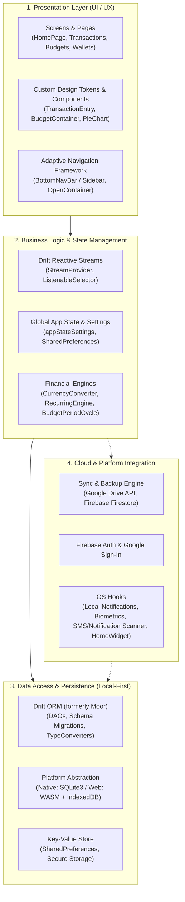
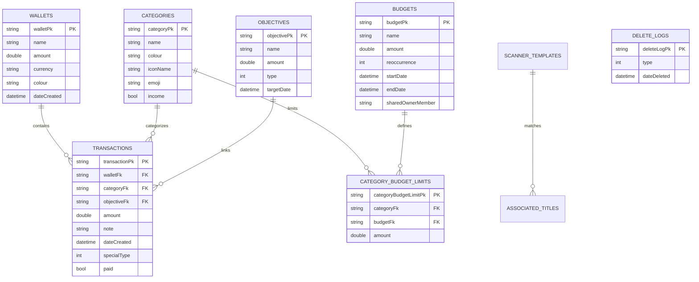
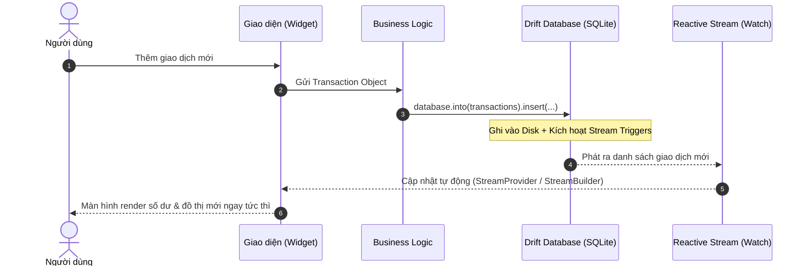
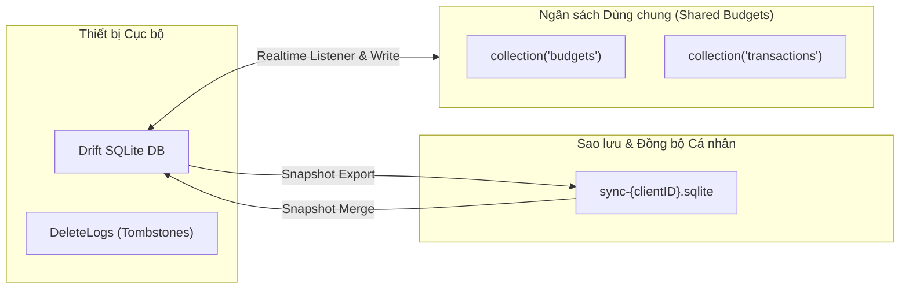

# PHÂN TÍCH KIẾN TRÚC HỆ THỐNG ỨNG DỤNG CASHEW (BUDGET & EXPENSE TRACKER)

---

## 1. TỔNG QUAN HỆ THỐNG (SYSTEM OVERVIEW)

**Cashew** là ứng dụng quản lý tài chính cá nhân, theo dõi chi tiêu và lập ngân sách đa nền tảng (Android, iOS, Web, macOS, Windows, Linux). 

### Triết lý thiết kế cốt lõi:
- **Local-First (Offline-First)**: Dữ liệu người dùng được lưu trữ và tính toán trực tiếp trên thiết bị thông qua SQLite cục bộ. Người dùng không cần tạo tài khoản hay có kết nối Internet để sử dụng toàn bộ tính năng cốt lõi.
- **Quyền riêng tư tuyệt đối (Privacy by Design)**: Không thu thập dữ liệu giao dịch về máy chủ trung tâm.
- **Phản hồi tức thì (Zero-Latency UI)**: Toàn bộ truy vấn đọc/ghi diễn ra trên local disk hoặc in-memory database, đảm bảo giao diện luôn đạt 60–120 FPS.
- **Hỗ trợ thích ứng đa nền tảng (Adaptive Multi-Platform)**: Tự động điều chỉnh layout giữa Mobile (Bottom Navigation, Full-width BottomSheets) và Tablet/Desktop/Web (Navigation Sidebar, Multi-pane).

---

## 2. KIẾN TRÚC TỔNG THỂ (HIGH-LEVEL ARCHITECTURE)

Ứng dụng Cashew được thiết kế theo mô hình **Kiến trúc Phân tầng (Layered Architecture)** kết hợp với cơ chế **Reactive Data Streams**:

### Chi tiết các tầng:
1. **Presentation Layer (Tầng hiển thị)**:
   - Xây dựng bằng Flutter Widgets tuân thủ chuẩn Material Design 3 tùy biến cao.
   - Quản lý điều hướng qua `NavigationFramework`: tự động nhận diện kích thước màn hình để hiển thị `BottomNavBar` trên điện thoại hoặc `NavigationSidebar` trên màn hình lớn.
   - Tối ưu hóa trải nghiệm chuyển cảnh với `OpenContainer` (Google Animations).
2. **Business Logic & State Layer (Tầng logic & trạng thái)**:
   - Sử dụng **Drift Reactive Queries (`watch()`)** phối hợp cùng `StreamProvider` để cập nhật giao diện theo thời gian thực ngay khi dữ liệu thay đổi.
   - Hệ thống quản lý chu kỳ ngân sách (`periodCyclePicker`), chuyển đổi ngoại tệ (`currencyFunctions`), tự động lập lịch hóa đơn định kỳ (`upcomingTransactionsFunctions`).
3. **Data Access & Persistence Layer (Tầng lưu trữ cục bộ)**:
   - Sử dụng **Drift ORM** trên nền tảng **SQLite3**.
   - Hỗ trợ đa nền tảng thông qua conditional imports: `native.dart` (Android, iOS, Windows, macOS, Linux) và `web.dart` (trên trình duyệt sử dụng WASM & IndexedDB).
4. **Cloud & Platform Integration Layer (Tầng dịch vụ ngoài & tích hợp OS)**:
   - Đồng bộ Snapshot qua Google Drive (`syncClient.dart`).
   - Đồng bộ ngân sách dùng chung giữa nhiều người dùng qua Cloud Firestore (`shareBudget.dart`).
   - Lắng nghe biến động số dư từ SMS/thông báo ngân hàng (`notification_listener_service`).

---

## 3. THIẾT KẾ CƠ SỞ DỮ LIỆU (DATABASE & DOMAIN MODEL)

Cơ sở dữ liệu của Cashew được quản lý bởi **Drift** với phiên bản lược đồ hiện tại là `schemaVersion = 46`, thể hiện sự phát triển và hoàn thiện qua rất nhiều phiên bản phát hành.

### Sơ đồ quan hệ thực thể cốt lõi (ERD):

### Các thực thể chính:
- **`Wallets`**: Quản lý tài khoản (tiền mặt, thẻ ngân hàng, ví điện tử), hỗ trợ đa đơn vị tiền tệ (`currency`), màu sắc và icon nhận diện.
- **`Transactions`**: Giao dịch thu/chi, chuyển tiền (`transfer`), các giao dịch định kỳ (`repetitive`), giao dịch nợ/cho vay (`credit/debt`), hình ảnh đính kèm và định vị.
- **`Categories` & `CategoryBudgetLimits`**: Danh mục chi tiêu đa cấp và giới hạn hạn mức chi tiêu theo danh mục trong từng ngân sách.
- **`Budgets`**: Ngân sách linh hoạt theo chu kỳ (ngày, tuần, tháng, năm, tùy chỉnh), hỗ trợ tích lũy sang kỳ sau (rollover) và chia sẻ qua cloud.
- **`Objectives`**: Mục tiêu tiết kiệm hoặc khoản vay/mượn cần theo dõi tiến độ hoàn thành.
- **`DeleteLogs` (Tombstone Pattern)**: Lưu trữ lịch sử các bản ghi đã xóa để phục vụ việc đồng bộ hai chiều (Two-way Sync) mà không gây trùng lặp hay sống lại dữ liệu cũ.

---

## 4. QUẢN LÝ TRẠNG THÁI & LUỒNG DỮ LIỆU (STATE MANAGEMENT & REACTIVE FLOW)

Khác với các ứng dụng truyền thống sử dụng BLoC hoặc Redux với nhiều boilerplate code, Cashew áp dụng kiến trúc **Database-Driven Reactive State**:

### Điểm đặc sắc trong quản lý trạng thái:
1. **Single Source of Truth**: Cơ sở dữ liệu SQLite là nguồn dữ liệu chuẩn duy nhất. Giao diện chỉ việc "lắng nghe" (`watch()`) luồng dữ liệu này.
2. **Không có độ trễ đồng bộ nội bộ**: Khi thêm, sửa hoặc xóa giao dịch ở bất kỳ màn hình nào (HomePage, WalletDetails, Search), toàn bộ các widget khác đang hiển thị đều tự động cập nhật mà không cần truyền callback hoặc event bus thủ công.
3. **`appStateSettings`**: Cấu hình ứng dụng được nạp đồng thời vào RAM (Map toàn cục) và lưu bền vững vào cả `SharedPreferences` lẫn bảng `AppSettings` trong DB để sao lưu đồng nhất.

---

## 5. CƠ CHẾ ĐỒNG BỘ & SAO LƯU (SYNC & CLOUD COLLABORATION)

Cashew áp dụng chiến lược đồng bộ lai (Hybrid Sync) để vừa đảm bảo quyền riêng tư vừa hỗ trợ làm việc cộng tác:

1. **Google Drive Sync (Sao lưu phân tán)**:
   - Mỗi thiết bị được định danh bằng một `clientID`.
   - Dữ liệu được đóng gói thành tệp SQLite snapshot đẩy lên Google Drive app folder cá nhân của người dùng.
   - Khi hợp nhất (merge), hệ thống so sánh mốc thời gian `dateUpdated` của từng bản ghi và đối chiếu với bảng `DeleteLogs` để giải quyết xung đột (Last-Write-Wins with Tombstones).
2. **Shared Budgets qua Cloud Firestore**:
   - Dành riêng cho tính năng chia sẻ ngân sách với gia đình, bạn bè hoặc nhóm.
   - Chỉ các ngân sách và giao dịch được chỉ định chia sẻ mới được đồng bộ lên Cloud Firestore.
   - Thành viên trong nhóm được phân quyền `owner` hoặc `member` thông qua Firebase Authentication.

---

## 6. TÍNH NĂNG NỀN TẢNG NỔI BẬT (PLATFORM HIGHLIGHTS)

| Thành phần | Công nghệ / Thư viện | Vai trò kiến trúc |
| :--- | :--- | :--- |
| **Tự động quét SMS/Email** | `notification_listener_service`, `ScannerTemplates` | Bắt thông báo biến động số dư từ ứng dụng ngân hàng, dùng Regex trích xuất số tiền, nội dung và tạo giao dịch tự động. |
| **Quy tắc gán nhãn tự động** | `AssociatedTitles` | Khi tên giao dịch khớp với từ khóa (ví dụ: "Grab", "Shopee"), ứng dụng tự động gán đúng Danh mục và Ví tương ứng. |
| **Bảo mật Sinh trắc học** | `local_auth`, `InitializeBiometrics` | Khóa ứng dụng bằng Face ID/Vân tay ngay khi khởi động hoặc quay lại từ nền (`OnAppResume`). |
| **Widget màn hình chính** | `home_widget` | Cung cấp Widget trên màn hình chính Android để xem nhanh số dư và thêm giao dịch một chạm. |
| **Quản lý đa ngôn ngữ** | `easy_localization` | Tải tài nguyên ngôn ngữ từ JSON, cập nhật `Locale` tức thì mà không cần khởi động lại toàn bộ app. |

---

## 7. ĐÁNH GIÁ KIẾN TRÚC (ARCHITECTURAL ASSESSMENT)

### 🌟 Ưu điểm:
- **Hiệu năng xuất sắc**: Kiến trúc Local-First trên nền Drift/SQLite đảm bảo tốc độ phản hồi tính bằng mili-giây, không phụ thuộc mạng.
- **Tính khả chuyển cao**: Mã nguồn chạy mượt mà trên cả Mobile (Android/iOS) lẫn Desktop/Web nhờ lớp trừu tượng hóa nền tảng (`database/platform`).
- **Khả năng phục hồi dữ liệu mạnh mẽ**: Hệ thống migration 46 phiên bản và cơ chế import/export dữ liệu độc lập giúp hạn chế tối đa nguy cơ mất mát dữ liệu của người dùng.
- **UI/UX hiện đại**: Hệ thống animation, hỗ trợ màn hình OLED đen tuyền, bảng màu thích ứng và bố cục đáp ứng chuẩn mực.

### ⚠️ Thách thức & Điểm cần tối ưu:
- **Tập tin quá lớn (Fat Files)**: Một số tệp chứa quá nhiều dòng code (ví dụ `tables.dart` > 7.600 dòng, `addTransactionPage.dart` > 200KB), gây khó khăn cho việc bảo trì và kiểm thử đơn vị (Unit Test).
- **Trạng thái toàn cục (Global Singletons)**: Một số biến toàn cục (`databaseGlobal`, `appStateSettings`, `functions.dart`) tạo ra sự phụ thuộc ẩn (tight coupling).
- **Tương thích phiên bản Flutter mới**: Do ứng dụng sử dụng nhiều plugin UI chuyên sâu (như `sliding_sheet`, `flutter_sticky_header`), khi nâng cấp Flutter SDK lên các phiên bản mới (Flutter 3.24+) cần kiểm soát xung đột API cẩn thận.

---

## 8. ĐỊNH HƯỚNG NÂNG CẤP KIẾN TRÚC (RECOMMENDED ROADMAP)

1. **Modular hóa tầng Cơ sở dữ liệu (Database Modularization)**:
   - Tách `tables.dart` thành các DAOs nhỏ riêng biệt: `WalletsDao`, `TransactionsDao`, `BudgetsDao`, `CategoriesDao` theo kiến trúc chuẩn của Drift.
2. **Áp dụng Dependency Injection (DI)**:
   - Sử dụng `get_it` hoặc chuyển dần sang `riverpod` để quản lý các services và repositories, loại bỏ các biến toàn cục và hỗ trợ viết Mock Unit Tests dễ dàng.
3. **Tách biệt Logic nghiệp vụ (Clean Architecture)**:
   - Tách các logic tính toán tài chính phức tạp khỏi các `StatefulWidget` vào các lớp UseCase / Service thuần túy (Pure Dart), tăng tính độc lập và khả năng tái sử dụng trên các nền tảng khác nhau.
