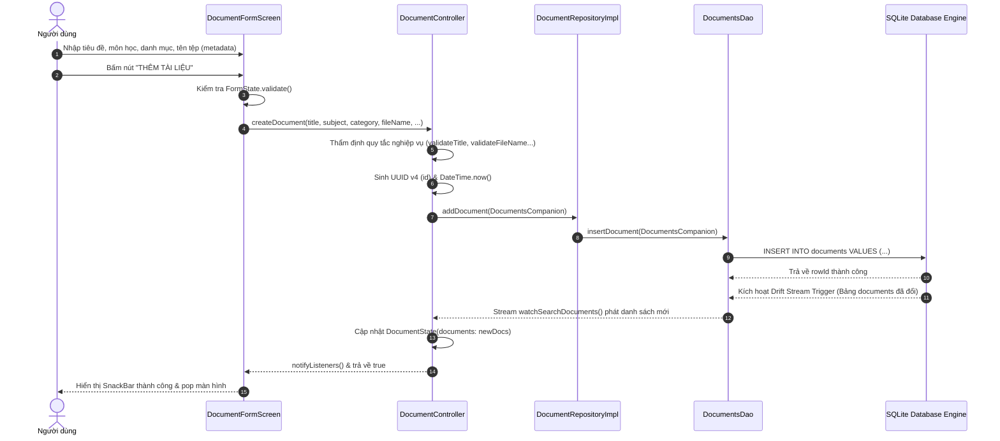
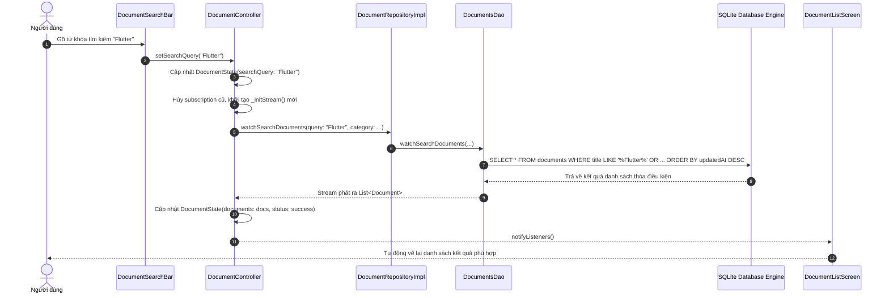

# BÁO CÁO PHÂN TÍCH HIỆN TRẠNG HỆ THỐNG QUẢN LÝ TÀI LIỆU HỌC TẬP
## ĐÁNH GIÁ KHẢ NĂNG CHUYỂN ĐỔI SANG MÔ HÌNH CLOUD (CHECKLIST 1)

* **Tên dự án:** Ứng dụng Quản lý Tài liệu Học tập (Document Management System)
* **Mã đề tài:** Khảo sát và Phân tích Hệ thống Hiện tại phục vụ Chuyển đổi Cloud
* **Đối tượng khảo sát:** Mã nguồn thực tế tại workspace `quan_ly_tai_lieu_hoc_tap`
* **Người thực hiện:** Nhóm sinh viên thực hiện đồ án
* **Ngày lập báo cáo:** 09/10/2026
* **Phạm vi thực hiện:** **Chỉ thực hiện Checklist 1** (Liệt kê và phân tích các thành phần cốt lõi: Frontend, Backend, Database, File Storage). Chưa tích hợp Firebase, chưa sửa code logic, chưa thay đổi cấu trúc database, chưa cài thêm package.

---

## 1. GIỚI THIỆU HỆ THỐNG HIỆN TẠI

### 1.1. Mục tiêu và phạm vi ứng dụng
Ứng dụng **"Quản lý Tài liệu Học tập"** được phát triển nhằm hỗ trợ sinh viên và người học tổ chức, phân loại, tìm kiếm và theo dõi các tài liệu học tập đa định dạng (Giáo trình, Slide bài giảng, Đề thi & Đáp án, Đồ án/Bài tập lớn, Ghi chú ôn tập). 

Mục tiêu cốt lõi của giai đoạn hiện tại là cung cấp khả năng quản lý danh mục tài liệu theo triết lý **Local-First** và **Offline-First**, đảm bảo ứng dụng có thể khởi chạy và hoạt động hoàn toàn độc lập mà không cần kết nối mạng.

### 1.2. Môi trường công nghệ và nền tảng hỗ trợ
Dựa trên khảo sát thực tế file [pubspec.yaml](file:///f:/FlutterProjects/quan_ly_tai_lieu_hoc_tap/pubspec.yaml) và mã nguồn:
* **Ngôn ngữ & SDK:** Dart SDK `^3.13.4`, Flutter Framework.
* **Mô hình kiến trúc nội bộ:** Phân tầng tách biệt (Layered Architecture): Presentation Layer, Business Logic & State Layer, Data Access Layer, và Local Persistence Layer.
* **Các nền tảng hỗ trợ theo mã nguồn thực tế:**
  * **Native Platforms (Android, iOS, Windows, macOS, Linux):** Tích hợp thông qua `sqlite3_flutter_libs` và `path_provider` (file [native.dart](file:///f:/FlutterProjects/quan_ly_tai_lieu_hoc_tap/lib/data/database/connection/native.dart)).
  * **Web Platform (Chrome, Edge, Firefox, Safari):** Tích hợp thông qua Drift Wasm (`sqlite3.wasm` và `drift_worker.js` lưu trữ trên IndexedDB - file [web.dart](file:///f:/FlutterProjects/quan_ly_tai_lieu_hoc_tap/lib/data/database/connection/web.dart)).

---

## 2. PHÂN TÍCH FRONTEND

### 2.1. Công nghệ giao diện và phong cách thiết kế
* **Giao diện:** Xây dựng bằng bộ Widget của **Flutter Material 3** (`uses-material-design: true` trong `pubspec.yaml`).
* **Design System / Tokens:** Mã màu và chủ đề được chuẩn hóa tại [app_colors.dart](file:///f:/FlutterProjects/quan_ly_tai_lieu_hoc_tap/lib/core/constants/app_colors.dart) và [app_theme.dart](file:///f:/FlutterProjects/quan_ly_tai_lieu_hoc_tap/lib/core/theme/app_theme.dart), hỗ trợ cả chế độ Sáng (Light Mode) và Tối (Dark Mode).
* **Biểu tượng:** Kết hợp `Icons` của Material Icons và `CupertinoIcons` (`cupertino_icons: ^1.0.8`).

### 2.2. Các màn hình chính (Screens)
Hệ thống hiện tại gồm có 3 màn hình chính:
1. **Màn hình danh sách tài liệu (`DocumentListScreen` - [document_list_screen.dart](file:///f:/FlutterProjects/quan_ly_tai_lieu_hoc_tap/lib/presentation/screens/document_list_screen.dart)):**
   * Là màn hình khởi động chính của ứng dụng (`home:` trong `MaterialApp`).
   * Hiển thị danh sách tài liệu dưới dạng cuộn (`ListView.builder`).
   * Tích hợp thanh tìm kiếm thời gian thực (`DocumentSearchBar`), thanh lọc danh mục cuộn ngang (`CategoryChipSelector`), và thanh tóm tắt số lượng tài liệu/số tài liệu yêu thích.
   * Cung cấp nút `FloatingActionButton` để điều hướng sang màn hình thêm mới tài liệu.
2. **Màn hình chi tiết tài liệu (`DocumentDetailScreen` - [document_detail_screen.dart](file:///f:/FlutterProjects/quan_ly_tai_lieu_hoc_tap/lib/presentation/screens/document_detail_screen.dart)):**
   * Nhận `documentId` làm tham số và truy xuất trạng thái phản ứng từ `DocumentController`.
   * Hiển thị đầy đủ thông tin: Tiêu đề, Môn học, Danh mục, Định dạng tệp, Dung lượng định dạng chuẩn (KB/MB), Ghi chú/mô tả học tập, Mã UUID, Tên tệp tin, Đường dẫn tệp tin, Thời gian tạo và cập nhật.
   * Cung cấp các hành động: Chuyển đổi trạng thái yêu thích, Mở màn hình chỉnh sửa (`DocumentFormScreen`), và Xóa tài liệu với hộp thoại xác nhận.
3. **Màn hình biểu mẫu tài liệu (`DocumentFormScreen` - [document_form_screen.dart](file:///f:/FlutterProjects/quan_ly_tai_lieu_hoc_tap/lib/presentation/screens/document_form_screen.dart)):**
   * Đảm nhiệm 2 chế độ: Thêm mới tài liệu (`widget.document == null`) hoặc Chỉnh sửa tài liệu (`isEditMode == true`).
   * Sử dụng `Form` và `GlobalKey<FormState>` quản lý các trường nhập liệu văn bản.
   * Tự động sinh tên tệp gợi ý dựa trên tiêu đề khi tạo mới tài liệu.
   * Cho phép chọn loại tệp qua `ChoiceChip` (PDF, DOCX, PPTX, XLSX, ZIP, CODE, TXT).

### 2.3. Các Widget quan trọng (Custom Widgets)
* **`DocumentCard` ([document_card.dart](file:///f:/FlutterProjects/quan_ly_tai_lieu_hoc_tap/lib/presentation/widgets/document_card.dart)):** Thẻ hiển thị thông tin tóm tắt từng tài liệu, có biểu tượng màu sắc đại diện cho từng loại tệp (PDF đỏ, Word xanh lam, Slide cam...), nút sao yêu thích tương tác nhanh, các huy hiệu (badge) môn học/danh mục, nút Sửa và Xóa.
* **`DocumentSearchBar` ([document_search_bar.dart](file:///f:/FlutterProjects/quan_ly_tai_lieu_hoc_tap/lib/presentation/widgets/document_search_bar.dart)):** Ô nhập tìm kiếm từ khóa kèm nút xóa nhanh (`clear`) và nút đổi chiều sắp xếp (cũ nhất / mới nhất).
* **`CategoryChipSelector` ([category_chip_selector.dart](file:///f:/FlutterProjects/quan_ly_tai_lieu_hoc_tap/lib/presentation/widgets/category_chip_selector.dart)):** Danh sách chip danh mục nằm ngang cho phép lọc tức thì (`Tất cả`, `Giáo trình`, `Slide bài giảng`, `Đề thi & Đáp án`...).
* **`EmptyStateView` ([empty_state_view.dart](file:///f:/FlutterProjects/quan_ly_tai_lieu_hoc_tap/lib/presentation/widgets/empty_state_view.dart)):** Hiển thị trực quan khi danh sách rỗng, khi không tìm thấy kết quả lọc, hoặc khi gặp lỗi truy vấn.
* **`ConfirmationDialog` ([confirmation_dialog.dart](file:///f:/FlutterProjects/quan_ly_tai_lieu_hoc_tap/lib/presentation/widgets/confirmation_dialog.dart)):** Modal xác nhận thao tác nguy hiểm (xóa tài liệu) nhằm phòng ngừa xóa nhầm.

### 2.4. Cơ chế điều hướng (Navigation)
* Ứng dụng hiện sử dụng cơ chế điều hướng nguyên thủy **Navigator 1.0** của Flutter (`Navigator.of(context).push(MaterialPageRoute(...))` và `Navigator.of(context).pop()`).
* **Hạn chế:** Chưa sử dụng Router khai báo cấp cao (như `go_router`), chưa hỗ trợ Deep Linking, chưa có cấu hình URL đồng bộ trên trình duyệt Web (tất cả các trang đều nằm trên route gốc `/`).

### 2.5. Quản lý trạng thái và tương tác với Business Logic
* **Giải pháp State Management:** Sử dụng thư viện `provider: ^6.1.5+1` kết hợp mô hình `ChangeNotifier`.
* **Cung cấp phụ thuộc (Dependency Injection):** Tại [main.dart](file:///f:/FlutterProjects/quan_ly_tai_lieu_hoc_tap/lib/main.dart), `MyApp` bọc toàn bộ widget tree bằng `MultiProvider`, cung cấp:
  * `Provider<DocumentRepository>`
  * `ChangeNotifierProvider<DocumentController>`
* **Cơ chế gọi Logic từ UI:** Giao diện người dùng **hoàn toàn không truy cập cơ sở dữ liệu hay DAO**. Mọi tương tác của UI đều ủy quyền qua các phương thức của `DocumentController` (như `controller.setSearchQuery()`, `controller.createDocument()`, `controller.deleteDocument()`).
* Giao diện cập nhật lại trạng thái thông qua `context.watch<DocumentController>()` khi controller phát tín hiệu `notifyListeners()`.

### 2.6. Bảng tổng hợp thành phần Frontend

| Thành phần | File thực tế | Vai trò | Trạng thái thực tế |
| :--- | :--- | :--- | :--- |
| **Giao diện gốc** | [lib/main.dart](file:///f:/FlutterProjects/quan_ly_tai_lieu_hoc_tap/lib/main.dart) | Cấu hình theme, nạp seed data, khởi tạo Provider | Đã triển khai hoàn chỉnh |
| **Màn hình danh sách** | [lib/presentation/screens/document_list_screen.dart](file:///f:/FlutterProjects/quan_ly_tai_lieu_hoc_tap/lib/presentation/screens/document_list_screen.dart) | Hiển thị danh sách phản ứng, tìm kiếm, lọc danh mục | Đã triển khai hoàn chỉnh |
| **Màn hình chi tiết** | [lib/presentation/screens/document_detail_screen.dart](file:///f:/FlutterProjects/quan_ly_tai_lieu_hoc_tap/lib/presentation/screens/document_detail_screen.dart) | Xem đầy đủ thông tin siêu dữ liệu của một tài liệu | Đã triển khai hoàn chỉnh |
| **Màn hình biểu mẫu** | [lib/presentation/screens/document_form_screen.dart](file:///f:/FlutterProjects/quan_ly_tai_lieu_hoc_tap/lib/presentation/screens/document_form_screen.dart) | Nhập liệu bằng tay metadata để thêm mới / cập nhật tài liệu | Đã triển khai hoàn chỉnh (Nhập văn bản) |
| **Thẻ tài liệu (Card)** | [lib/presentation/widgets/document_card.dart](file:///f:/FlutterProjects/quan_ly_tai_lieu_hoc_tap/lib/presentation/widgets/document_card.dart) | Render từng bản ghi tài liệu trong danh sách | Đã triển khai hoàn chỉnh |
| **Thanh tìm kiếm** | [lib/presentation/widgets/document_search_bar.dart](file:///f:/FlutterProjects/quan_ly_tai_lieu_hoc_tap/lib/presentation/widgets/document_search_bar.dart) | Tiếp nhận từ khóa tìm kiếm & nút đảo chiều sắp xếp | Đã triển khai hoàn chỉnh |
| **Thanh lọc danh mục** | [lib/presentation/widgets/category_chip_selector.dart](file:///f:/FlutterProjects/quan_ly_tai_lieu_hoc_tap/lib/presentation/widgets/category_chip_selector.dart) | Lọc nhanh theo các danh mục chuẩn | Đã triển khai hoàn chỉnh |
| **Trạng thái rỗng / Lỗi** | [lib/presentation/widgets/empty_state_view.dart](file:///f:/FlutterProjects/quan_ly_tai_lieu_hoc_tap/lib/presentation/widgets/empty_state_view.dart) | Hiển thị thông báo khi không có tài liệu hoặc lỗi | Đã triển khai hoàn chỉnh |
| **Hộp thoại xác nhận** | [lib/presentation/widgets/confirmation_dialog.dart](file:///f:/FlutterProjects/quan_ly_tai_lieu_hoc_tap/lib/presentation/widgets/confirmation_dialog.dart) | Modal cảnh báo xác nhận trước khi xóa dữ liệu | Đã triển khai hoàn chỉnh |
| **Bộ chọn tệp từ máy (File Picker)** | *Chưa có file* | Cho phép bấm nút duyệt file từ bộ nhớ máy tính/điện thoại | **Chưa triển khai** (Không có trong code) |
| **Trình đọc/xem tài liệu (Viewer)** | *Chưa có file* | Mở xem nội dung PDF, hình ảnh, văn bản trực tiếp | **Chưa triển khai** (Không có trong code) |

---

## 3. PHÂN TÍCH BACKEND

Sau khi khảo sát toàn bộ cấu trúc dự án và các tệp cấu hình, kết quả phân tích Backend như sau:

### 3.1. Sự tồn tại của Backend Server riêng
* **Thực tế:** Dự án **HOÀN TOÀN KHÔNG CÓ Backend Server riêng biệt**.
* Không có bất kỳ thư mục mã nguồn nào của server (Node.js/Express, Spring Boot, Python/FastAPI, Go, .NET...).
* Không có tệp cấu hình triển khai máy chủ, Dockerfile, Docker Compose hay cấu hình reverse proxy nào.

### 3.2. REST API / GraphQL API / Dịch vụ mạng
* **Thực tế:** Dự án **HOÀN TOÀN KHÔNG SỬ DỤNG REST API hoặc GraphQL API**.
* Kiểm tra [pubspec.yaml](file:///f:/FlutterProjects/quan_ly_tai_lieu_hoc_tap/pubspec.yaml) cho thấy: Không cài đặt bất kỳ package HTTP client nào như `http`, `dio`, `retrofit`, hay `graphql_flutter`.
* Không có file nào trong thư mục `lib/` thực hiện lời gọi mạng hoặc định nghĩa endpoint API.

### 3.3. Dịch vụ Cloud Backend (BaaS)
* **Thực tế:** Dự án **CHƯA TÍCH HỢP bất kỳ dịch vụ Backend-as-a-Service nào**.
* Không có Firebase SDK (`firebase_core`, `cloud_firestore`, `firebase_auth`, `firebase_storage`).
* Không có Supabase, AWS Amplify, Appwrite hay dịch vụ lưu trữ đám mây nào khác.

### 3.4. Vị trí thực thi Business Logic
Toàn bộ Business Logic của hệ thống hiện đang **chạy trực tiếp 100% trong ứng dụng Flutter trên thiết bị người dùng (Client-Side)**:
* **Thẩm định dữ liệu (Input Validation):** Các phương thức `validateTitle()`, `validateSubject()`, `validateCategory()`, `validateFileName()`, `validateFileType()` được cài đặt trực tiếp trong [DocumentController](file:///f:/FlutterProjects/quan_ly_tai_lieu_hoc_tap/lib/logic/controllers/document_controller.dart#L113-L153).
* **Sinh định danh (Identity Generation):** Mã UUID của tài liệu được sinh cục bộ tại Client bằng thư viện `uuid: ^4.6.0` (`_uuid.v4()`).
* **Lọc và sắp xếp (Filter & Sort):** Logic lọc chuỗi, ghép mệnh đề SQL và sắp xếp được điều khiển bởi Client và thực thi trực tiếp trên database engine SQLite cục bộ.

### 3.5. Phân định ranh giới kiến trúc
Cần phân biệt rõ ràng để tránh nhầm lẫn:
* **Presentation Layer:** Các Screen và Custom Widget chịu trách nhiệm hiển thị và nhận sự kiện.
* **Business Logic & State Layer:** Lớp `DocumentController` và `DocumentState` chỉ là bộ điều phối trạng thái và kiểm tra ràng buộc ở tầng Client của Flutter, **không phải là Backend Server**.
* **Data Access Layer:** Lớp `DocumentRepository` và `DocumentsDao` là lớp trung gian trừu tượng hóa thao tác với Drift SQLite cục bộ, **không phải là API Client giao tiếp với Server**.
* **Backend Server thực sự:** **Chưa tồn tại trong hệ thống.**

---

## 4. PHÂN TÍCH DATABASE

### 4.1. Công nghệ cơ sở dữ liệu
* **Cơ sở dữ liệu:** **SQLite cục bộ (Local-First SQLite)**.
* **Công cụ ánh xạ & ORM:** **Drift ORM** (phiên bản `^2.35.1`, trước đây là Moor).
* **Trình sinh mã:** Sử dụng `drift_dev: ^2.35.1` và `build_runner: ^2.16.1` để tự động tạo lớp ánh xạ dữ liệu strongly-typed tại [app_database.g.dart](file:///f:/FlutterProjects/quan_ly_tai_lieu_hoc_tap/lib/data/database/app_database.g.dart) và [documents_dao.g.dart](file:///f:/FlutterProjects/quan_ly_tai_lieu_hoc_tap/lib/data/database/daos/documents_dao.g.dart).

### 4.2. Khởi tạo và kết nối cơ sở dữ liệu
* **Tệp định nghĩa Database chính:** [lib/data/database/app_database.dart](file:///f:/FlutterProjects/quan_ly_tai_lieu_hoc_tap/lib/data/database/app_database.dart). Lớp `AppDatabase` kế thừa từ `_$AppDatabase` với `schemaVersion = 1`.
* **Cơ chế trừu tượng hóa kết nối đa nền tảng:** Được tổ chức trong thư mục [lib/data/database/connection/](file:///f:/FlutterProjects/quan_ly_tai_lieu_hoc_tap/lib/data/database/connection/):
  * [connection.dart](file:///f:/FlutterProjects/quan_ly_tai_lieu_hoc_tap/lib/data/database/connection/connection.dart): Conditional export sử dụng `dart.library.io` và `dart.library.js_interop`.
  * [native.dart](file:///f:/FlutterProjects/quan_ly_tai_lieu_hoc_tap/lib/data/database/connection/native.dart): Mở file vật lý `hoc_tap_documents.sqlite` trong thư mục `getApplicationDocumentsDirectory()` bằng `NativeDatabase.createInBackground()`.
  * [web.dart](file:///f:/FlutterProjects/quan_ly_tai_lieu_hoc_tap/lib/data/database/connection/web.dart): Khởi tạo cơ sở dữ liệu trên trình duyệt qua `WasmDatabase.open()` liên kết với `sqlite3.wasm` và `drift_worker.js` (IndexedDB persistence).

### 4.3. Cấu trúc bảng dữ liệu
Hệ thống hiện tại có duy nhất **1 bảng dữ liệu**: `Documents` (tên sinh trong SQLite là `documents`), được định nghĩa tại [lib/data/database/tables/documents_table.dart](file:///f:/FlutterProjects/quan_ly_tai_lieu_hoc_tap/lib/data/database/tables/documents_table.dart).

Chi tiết các cột trong bảng:
| Tên cột | Kiểu Drift | Kiểu SQLite | Ràng buộc | Ý nghĩa và vai trò |
| :--- | :--- | :--- | :--- | :--- |
| `id` | `TextColumn` | `TEXT` | `PRIMARY KEY` | Khóa chính dạng chuỗi UUID (v4) sinh độc lập tại client. |
| `title` | `TextColumn` | `TEXT` | `NOT NULL`, độ dài 1..200 | Tiêu đề của tài liệu học tập. |
| `description` | `TextColumn` | `TEXT` | `NULLABLE` | Ghi chú, tóm tắt hoặc nội dung học tập bổ trợ. |
| `subject` | `TextColumn` | `TEXT` | `NOT NULL`, độ dài 1..100 | Môn học (VD: Lập trình Flutter, Kiến trúc Phần mềm...). |
| `category` | `TextColumn` | `TEXT` | `NOT NULL`, độ dài 1..100 | Danh mục phân loại (Giáo trình, Slide, Đề thi...). |
| `fileName` | `TextColumn` | `TEXT` | `NOT NULL`, độ dài 1..255 | Tên tệp tin hiển thị (VD: `giao_trinh_flutter.pdf`). |
| `filePath` | `TextColumn` | `TEXT` | `NULLABLE` | Chuỗi đường dẫn tệp trên ổ đĩa / URI giả định. |
| `fileType` | `TextColumn` | `TEXT` | `NOT NULL`, độ dài 1..20 | Đuôi loại tệp (PDF, DOCX, PPTX, XLSX, ZIP, CODE, TXT). |
| `fileSize` | `IntColumn` | `INTEGER` | `NOT NULL`, default: 0 | Dung lượng tệp tính bằng byte. |
| `isFavorite` | `BoolColumn` | `INTEGER` | `NOT NULL`, default: false | Trạng thái đánh dấu tài liệu yêu thích / ưu tiên. |
| `createdAt` | `DateTimeColumn`| `INTEGER` | `NOT NULL`, default: now() | Thời gian tạo bản ghi tài liệu. |
| `updatedAt` | `DateTimeColumn`| `INTEGER` | `NOT NULL`, default: now() | Thời gian cập nhật bản ghi gần nhất. |

### 4.4. Tầng truy cập dữ liệu (DAO & Repository)
* **DAO (`DocumentsDao` - [documents_dao.dart](file:///f:/FlutterProjects/quan_ly_tai_lieu_hoc_tap/lib/data/database/daos/documents_dao.dart)):** Cung cấp các thao tác CRUD trực tiếp trên bảng `Documents`:
  * `insertDocument(DocumentsCompanion)`: Chèn tài liệu mới vào SQLite.
  * `getAllDocuments()` / `getDocumentById(String id)`: Truy vấn danh sách snapshot.
  * `updateDocument(DocumentsCompanion)`: Cập nhật thông tin tài liệu.
  * `deleteDocument(String id)`: Xóa tài liệu theo ID.
  * `toggleFavorite(String id, bool currentStatus)`: Đảo ngược cờ yêu thích và cập nhật `updatedAt`.
  * `getAllDistinctSubjects()` / `getAllDistinctCategories()`: Lấy danh sách môn học và danh mục không trùng lặp.
* **Repository Interface & Implementation:**
  * Interface [document_repository.dart](file:///f:/FlutterProjects/quan_ly_tai_lieu_hoc_tap/lib/data/repositories/document_repository.dart) định nghĩa trừu tượng hóa các phương thức.
  * Lớp triển khai [document_repository_impl.dart](file:///f:/FlutterProjects/quan_ly_tai_lieu_hoc_tap/lib/data/repositories/document_repository_impl.dart) đóng gói các lệnh gọi tới `DocumentsDao`, bảo vệ tầng Logic không bị phụ thuộc cứng vào Drift.

### 4.5. Cơ chế tìm kiếm và Reactive Stream (`watch()`)
* **Tìm kiếm và lọc đa tiêu chí:** Triển khai trong phương thức `watchSearchDocuments()` của DAO. Sử dụng biểu thức SQL `LIKE %query%` kết hợp toán tử OR trên các cột `title`, `subject`, `category`, `fileName`, `description`; đồng thời kết hợp toán tử AND để lọc chính xác theo `category` và `subject`.
* **Phản ứng thời gian thực (Reactive Streams):** Sử dụng cơ chế `query.watch()` của Drift. Khi có bất kỳ thao tác ghi nào (INSERT, UPDATE, DELETE), cơ chế triggers nội bộ của SQLite/Drift sẽ tự động kích hoạt và phát một danh sách tài liệu mới qua Stream mà không cần UI phải gọi lại lệnh tải dữ liệu thủ công.

### 4.6. Lưu trữ và đồng bộ hóa dữ liệu
* **Nơi lưu trữ:** Dữ liệu hoàn toàn **lưu trữ cục bộ trên thiết bị vật lý** (trong file `.sqlite` của ứng dụng hoặc IndexedDB của trình duyệt).
* **Đồng bộ hóa (Cloud Sync):** **HOÀN TOÀN KHÔNG CÓ CƠ CHẾ ĐỒNG BỘ CLOUD NÀO ĐƯỢC CÀI ĐẶT**.
  * Dữ liệu trên thiết bị nào chỉ tồn tại độc lập trên thiết bị đó.
  * Không có cơ chế giải quyết xung đột (Conflict Resolution), không có Last-Write-Wins (LWW), không có đồng bộ nền.
  * Nếu người dùng gỡ ứng dụng hoặc đổi thiết bị, toàn bộ dữ liệu sẽ bị mất.

### 4.7. Bảng tổng hợp thành phần Database

| Thành phần | Công nghệ | File thực tế | Vai trò | Hạn chế hiện tại |
| :--- | :--- | :--- | :--- | :--- |
| **Định nghĩa bảng** | Drift ORM | [lib/data/database/tables/documents_table.dart](file:///f:/FlutterProjects/quan_ly_tai_lieu_hoc_tap/lib/data/database/tables/documents_table.dart) | Khai báo schema bảng Documents | Chỉ lưu metadata; chưa có trường metadata cho Cloud (e.g. `cloudUrl`, `syncStatus`) |
| **Cơ sở dữ liệu** | Drift / SQLite | [lib/data/database/app_database.dart](file:///f:/FlutterProjects/quan_ly_tai_lieu_hoc_tap/lib/data/database/app_database.dart) | Quản trị schema, version, migration | Chỉ hoạt động cục bộ (schemaVersion = 1), chưa có logic remote sync |
| **Kết nối Native** | SQLite3 C library | [lib/data/database/connection/native.dart](file:///f:/FlutterProjects/quan_ly_tai_lieu_hoc_tap/lib/data/database/connection/native.dart) | Mở file SQLite trên mobile/desktop OS | File chỉ nằm trên filesystem cục bộ của một thiết bị |
| **Kết nối Web** | Drift WASM / IndexedDB | [lib/data/database/connection/web.dart](file:///f:/FlutterProjects/quan_ly_tai_lieu_hoc_tap/lib/data/database/connection/web.dart) | Lưu trữ CSDL trên trình duyệt Web | Dữ liệu gắn liền với browser profile, dễ bị xóa khi dọn cache |
| **DAO** | Drift Accessor | [lib/data/database/daos/documents_dao.dart](file:///f:/FlutterProjects/quan_ly_tai_lieu_hoc_tap/lib/data/database/daos/documents_dao.dart) | Cung cấp CRUD và Reactive Stream | Chỉ thao tác với SQLite cục bộ, không gửi/nhận dữ liệu từ remote server |
| **Repository** | Repository Pattern | [lib/data/repositories/document_repository_impl.dart](file:///f:/FlutterProjects/quan_ly_tai_lieu_hoc_tap/lib/data/repositories/document_repository_impl.dart) | Lớp trừu tượng trung gian giữa Logic và DAO | Chưa có nhánh điều hướng đọc/ghi kết hợp Local và Remote DataSource |

---

## 5. PHÂN TÍCH FILE STORAGE

Đây là phần khảo sát quan trọng nhất để làm rõ sự khác biệt giữa kỳ vọng của một hệ thống quản lý tài liệu và mã nguồn thực tế hiện có.

### 5.1. Khảo sát thực tế việc xử lý tệp
1. **Ứng dụng có lưu file nhị phân (PDF, DOCX, PPTX...) thực tế không?**
   * **KHÔNG.** Hệ thống hiện tại **hoàn toàn KHÔNG lưu trữ nội dung tệp nhị phân (binary content / byte array / blob)** ở bất kỳ đâu (kể cả trong database hay trên ổ cứng thiết bị).
2. **File có được chọn từ thiết bị không?**
   * **KHÔNG.** Trong [DocumentFormScreen](file:///f:/FlutterProjects/quan_ly_tai_lieu_hoc_tap/lib/presentation/screens/document_form_screen.dart), không hề có nút bấm "Chọn tệp từ máy", không có hộp thoại mở file hệ thống. Người dùng phải nhập tay tên tệp vào ô `TextFormField(_fileNameController)` và nhập dung lượng vào ô `TextFormField(_fileSizeKbController)`.
3. **Có thao tác upload hoặc download file không?**
   * **KHÔNG.** Mã nguồn không có bất kỳ logic nào tải file lên (upload) hay tải file về (download).
4. **File có được sao chép/lưu vào File System của thiết bị không?**
   * **KHÔNG.** Lớp [FileHelper](file:///f:/FlutterProjects/quan_ly_tai_lieu_hoc_tap/lib/core/utils/file_helper.dart) chỉ chứa các hàm tiện ích định dạng chuỗi (`formatFileSize`, `formatDate`, `getFileTypeColor`, `getFileTypeIcon`), hoàn toàn không có hàm nào thực hiện I/O đọc ghi file nhị phân qua `dart:io` hay ghi byte vào ổ đĩa.
5. **Database lưu nội dung file hay chỉ lưu đường dẫn/tên?**
   * Database chỉ lưu **chuỗi ký tự (TEXT)** mô tả tên tệp (`fileName`) và đường dẫn tham chiếu tùy chọn (`filePath`). Cột `filePath` là chuỗi text nullable và người dùng có thể tự gõ bất kỳ chuỗi nào vào form.
6. **Có sử dụng package File Picker hoặc liên quan không?**
   * **KHÔNG.** `pubspec.yaml` không có `file_picker`, `image_picker`, hay bất kỳ plugin chọn file nào.
7. **Có sử dụng Firebase Storage, AWS S3 hoặc dịch vụ Cloud Storage khác không?**
   * **KHÔNG CÓ.**
8. **Có cơ chế xác thực hoặc phân quyền truy cập file không?**
   * **KHÔNG CÓ.** Ứng dụng không có hệ thống tài khoản người dùng, không có Authentication, không có Authorization hay Token/Signed URL.

### 5.2. Phân định rõ 3 khái niệm cốt lõi trong hệ thống hiện tại
* **1. Thông tin mô tả tài liệu (Metadata):** Tiêu đề, tên môn học, danh mục, tên tệp, định dạng, kích thước tính bằng byte, ngày tạo/cập nhật, cờ yêu thích.
  * *Hiện trạng:* **ĐÃ CÓ ĐẦY ĐỦ** trong SQLite/Drift.
* **2. Đường dẫn tham chiếu (File Reference / URI):** Cột `filePath` trong bảng `Documents`.
  * *Hiện trạng:* **CHỈ LÀ CHUỖI VĂN BẢN (TEXT STRING)**. Trong dữ liệu mẫu khởi tạo tại [main.dart](file:///f:/FlutterProjects/quan_ly_tai_lieu_hoc_tap/lib/main.dart#L45), các đường dẫn như `filePath: '/docs/flutter/giao_trinh_flutter_nang_cao.pdf'` chỉ là chuỗi text giả lập phục vụ hiển thị demo trên UI, hoàn toàn không có file vật lý tương ứng tồn tại trên ổ đĩa.
* **3. Nội dung tệp thực tế (Binary File Content):** Dòng byte nhị phân của tài liệu để người dùng có thể mở ra đọc, xem trước hoặc tải về.
  * *Hiện trạng:* **HOÀN TOÀN CHƯA CÓ**.

> **Kết luận File Storage:** Hệ thống hiện tại chỉ là một **ứng dụng quản lý Siêu dữ liệu (Metadata Management System)** cho tài liệu học tập, **CHƯA PHẢI là một hệ thống Lưu trữ Tệp tin (File Storage System) thực sự**.

---

## 6. MÔ TẢ KIẾN TRÚC HIỆN TẠI (AS-IS)

### 6.1. Sơ đồ kiến trúc tổng thể AS-IS
Sơ đồ sau đây mô tả chính xác các thành phần thực sự tồn tại trong mã nguồn hiện tại của dự án:

```mermaid
graph TD
    subgraph ClientDevice ["Thiết bị Người dùng (Client-Side Only)"]
        subgraph PresentationLayer ["1. Presentation Layer (UI)"]
            UI_Screens["Screens:<br/>• DocumentListScreen<br/>• DocumentDetailScreen<br/>• DocumentFormScreen"]
            UI_Widgets["Widgets & Dialogs:<br/>• DocumentCard<br/>• DocumentSearchBar<br/>• CategoryChipSelector<br/>• ConfirmationDialog<br/>• EmptyStateView"]
            UI_Screens --> UI_Widgets
        end

        subgraph LogicLayer ["2. Business Logic & State Layer"]
            Controller["DocumentController (ChangeNotifier)"]
            State["DocumentState (Immutable)"]
            Validation["Input Validation Guards"]
            Controller --> State
            Controller --> Validation
        end

        subgraph DataAccessLayer ["3. Data Access & Persistence Layer"]
            Repo["DocumentRepository / DocumentRepositoryImpl"]
            DAO["DocumentsDao (Drift Accessor)"]
            Repo --> DAO
        end

        subgraph LocalDatabase ["4. Local Persistence Engine"]
            DriftDB["AppDatabase (Drift ORM)"]
            SQLite_Native["Native SQLite<br/>(hoc_tap_documents.sqlite)"]
            SQLite_Web["Web Wasm SQLite<br/>(IndexedDB Persistence)"]
            DriftDB --> SQLite_Native
            DriftDB --> SQLite_Web
        end

        PresentationLayer -->|Gọi hàm nghiệp vụ| LogicLayer
        LogicLayer -->|Truy xuất dữ liệu| DataAccessLayer
        DataAccessLayer -->|Thực thi SQL Queries| DriftDB
        DriftDB -.->|Reactive Stream watch()| DAO
        DAO -.->|Stream phát dữ liệu mới| LogicLayer
        LogicLayer -.->|notifyListeners() / Re-render| PresentationLayer
    end

    subgraph MissingComponents ["Thành phần Chưa có trong Hệ thống"]
        No_BackendServer["KHÔNG CÓ Backend Server (Node.js/Spring Boot/Go...)"]
        No_REST_API["KHÔNG CÓ REST API / GraphQL API"]
        No_CloudDB["KHÔNG CÓ Cloud Database (Firestore / PostgreSQL...)"]
        No_CloudStorage["KHÔNG CÓ Cloud Storage (Firebase Storage / S3...)"]
        No_FileStorage["KHÔNG CÓ Local Physical File Storage"]
    end

    style MissingComponents fill:#ffebee,stroke:#c62828,stroke-dasharray: 5 5
    style ClientDevice fill:#f5f5f5,stroke:#333
```

---

## 7. LUỒNG DỮ LIỆU HIỆN TẠI (DATA FLOW)

### 7.1. Luồng dữ liệu khi Thêm tài liệu mới (Create Document)
Dưới đây là trình tự thực tế khi người dùng nhập biểu mẫu và lưu tài liệu:



### 7.2. Luồng dữ liệu khi Tìm kiếm và Lọc tài liệu (Reactive Search Flow)
Dưới đây là cách hệ thống xử lý khi người dùng nhập từ khóa tìm kiếm hoặc chọn danh mục:



### 7.3. Luồng xử lý tệp tin (File Handling Flow)
* **Thực tế:** Không có luồng truyền nhận tệp vật lý.
* Người dùng chỉ nhập các chuỗi văn bản mô tả tên file và kích cỡ ước tính.
* Không có thao tác đọc file từ ổ cứng, không có mảng byte được chuyển giao, không có file nào được lưu vào sandbox của thiết bị.

---

## 8. BẢNG TỔNG HỢP THÀNH PHẦN

Bảng sau đây tổng hợp toàn bộ các thành phần của hệ thống ứng dụng Quản lý Tài liệu Học tập:

| Nhóm chức năng | Tên thành phần | Trạng thái hiện tại | Vị trí thực thi | Mức độ tái sử dụng khi tích hợp Cloud |
| :--- | :--- | :--- | :--- | :--- |
| **Frontend - Màn hình** | `DocumentListScreen` | Đã có, hoạt động tốt | Client | **Tái sử dụng 100%**: Chỉ cần giữ nguyên UI, UI tự động cập nhật khi State đổi. |
| **Frontend - Màn hình** | `DocumentDetailScreen`| Đã có, hoạt động tốt | Client | **Tái sử dụng 90%**: Cần thêm nút "Mở file / Tải file" sau khi tích hợp Cloud Storage. |
| **Frontend - Màn hình** | `DocumentFormScreen`  | Đã có (nhập text) | Client | **Tái sử dụng 60%**: Cần thay ô nhập tay tên/kích cỡ file bằng nút chọn file thực tế (File Picker). |
| **Frontend - Widgets** | `DocumentCard`, `DocumentSearchBar`, `CategoryChipSelector` | Đã có, hoạt động tốt | Client | **Tái sử dụng 100%**: Các widget hiển thị và lọc hoạt động độc lập với nguồn dữ liệu. |
| **Frontend - Xử lý tệp** | Chọn file từ thiết bị (File Picker) | **Chưa có** | Client | **Cần xây dựng mới** bằng package như `file_picker`. |
| **Logic - Quản lý trạng thái** | `DocumentController` & `DocumentState` | Đã có, hoạt động tốt | Client | **Tái sử dụng 80%**: Bổ sung các phương thức upload/sync và quản lý tiến trình (Progress State). |
| **Logic - Thẩm định** | Validation logic (Title, Subject...) | Đã có, hoạt động tốt | Client | **Tái sử dụng 100%**: Giữ nguyên làm Client-Side Validation Guards. |
| **Data - Trừu tượng hóa** | `DocumentRepository` | Đã có | Client | **Tái sử dụng 70%**: Mở rộng để đóng gói cả Local DataSource (Drift) và Remote DataSource (Firebase/Cloud). |
| **Database - Cục bộ** | Drift ORM / SQLite | Đã có, hoạt động tốt | Client | **Tái sử dụng 90%**: Đóng vai trò Local Cache / Local Database trong mô hình Offline-First. Cần thêm trường metadata phục vụ đồng bộ. |
| **Database - Đám mây** | Cloud Database (Firestore / Cloud SQL) | **Chưa có** | Cloud | **Cần xây dựng mới** để đồng bộ dữ liệu giữa nhiều thiết bị. |
| **File Storage - Cục bộ** | Thư mục lưu tệp vật lý | **Chưa có** | Client | **Cần xây dựng mới** để cache file tải về hoặc lưu file tạm. |
| **File Storage - Đám mây**| Cloud Storage (Firebase Storage / S3) | **Chưa có** | Cloud | **Cần xây dựng mới** để lưu file nhị phân (PDF, DOCX, PPTX...). |
| **Backend - Máy chủ** | Backend Server / API Gateway | **Chưa có** | Server | **Tùy chọn mô hình**: Có thể dùng trực tiếp BaaS (Firebase) hoặc xây dựng Backend Server riêng. |
| **Bảo mật & Xác thực** | Authentication / User Identity | **Chưa có** | Client / Cloud | **Cần xây dựng mới** để phân quyền dữ liệu theo từng sinh viên/người dùng. |

---

## 9. KẾT LUẬN HIỆN TRẠNG

### 9.1. Những thành phần đã có
1. **Kiến trúc phân tầng hoàn chỉnh:** Ranh giới giữa Presentation, Business Logic và Data Access được phân định rõ ràng, đúng chuẩn kiến trúc phần mềm.
2. **Giao diện người dùng Material 3 hoàn chỉnh:** Đã có đầy đủ màn hình danh sách, chi tiết, biểu mẫu nhập liệu và các widget chuyên biệt, hỗ trợ cả Dark/Light Theme.
3. **Cơ sở dữ liệu cục bộ mạnh mẽ:** Drift ORM trên SQLite hoạt động ổn định trên cả nền tảng Native và Web, có hỗ trợ Reactive Streams (`watch()`) cập nhật dữ liệu tự động.
4. **Quản lý Siêu dữ liệu (Metadata) toàn diện:** Quản lý đầy đủ các trường thông tin của tài liệu (tiêu đề, môn học, danh mục, thời gian, trạng thái yêu thích, tên file, định dạng, kích thước).
5. **Cơ chế định danh phân tán:** Khóa chính của tài liệu là chuỗi UUID (v4) được sinh tại Client, là nền tảng cực kỳ thuận lợi cho việc chuyển đổi sang mô hình cơ sở dữ liệu phân tán hoặc Cloud Sync mà không lo xung đột khóa chính tự tăng.

### 9.2. Những thành phần chưa có
1. **Chưa có Backend Server độc lập:** Không có REST/GraphQL API hay server xử lý nghiệp vụ.
2. **Chưa có Cloud Database:** Dữ liệu hoàn toàn cô lập trên từng thiết bị, chưa có cơ chế đồng bộ đa thiết bị.
3. **Chưa có File Storage thực sự:** Ứng dụng chưa lưu trữ nội dung file nhị phân, chưa có cơ chế chọn file từ bộ nhớ máy, chưa có upload/download file.
4. **Chưa có Hệ thống Xác thực & Phân quyền (Authentication & Authorization):** Ứng dụng hoạt động vô danh (anonymous/single-user local), chưa gắn dữ liệu với tài khoản người dùng cụ thể.

### 9.3. Đánh giá tính khả thi chuyển đổi Cloud
Nhờ cấu trúc mã nguồn được tổ chức tốt theo mô hình phân tầng và Repository Pattern, ứng dụng hiện tại có **khả năng chuyển đổi sang mô hình Cloud rất cao**:
* Tầng UI và phần lớn Business Logic có thể giữ nguyên vẹn.
* Cơ sở dữ liệu SQLite hiện tại không cần vứt bỏ mà có thể tái sử dụng làm tầng **Local Cache** hoàn hảo trong mô hình **Offline-First Cloud Sync** (ví dụ tích hợp Firebase Cloud Firestore với cơ chế đồng bộ qua Repository).
* Việc bổ sung lưu trữ tệp chỉ cần mở rộng tại tầng Repository/Service (tích hợp thêm File Picker và Firebase Storage) mà không làm phá vỡ cấu trúc giao diện hiện tại.

### 9.4. Những điểm chưa thể xác minh từ mã nguồn
1. **Dung lượng và định dạng file thực tế người dùng sẽ tải lên:** Hiện tại chỉ có các hằng số gợi ý trong [app_constants.dart](file:///f:/FlutterProjects/quan_ly_tai_lieu_hoc_tap/lib/core/constants/app_constants.dart) và các trường số nhập tay, chưa có giới hạn dung lượng thực tế của file nhị phân.
2. **Yêu cầu bảo mật và quyền riêng tư của tài liệu:** Mã nguồn chưa thể hiện tài liệu là công khai cho mọi sinh viên hay là tài liệu riêng tư của từng cá nhân (cần xác nhận yêu cầu nghiệp vụ ở các checklist tiếp theo).
