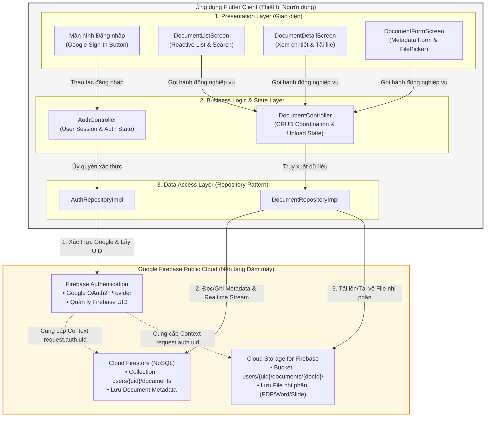
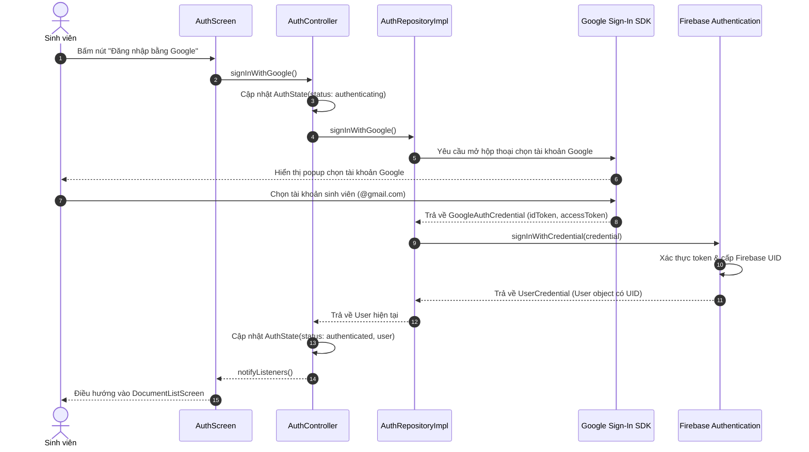
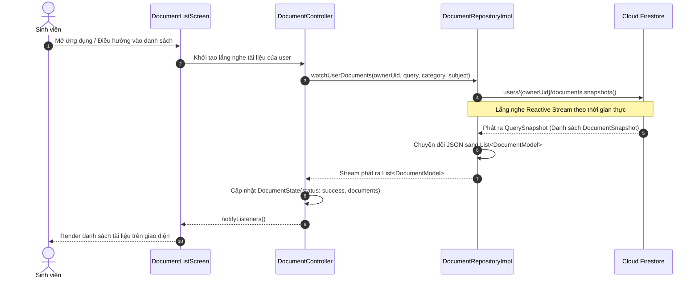
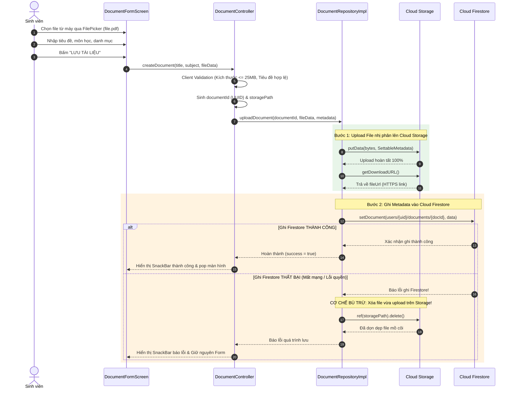
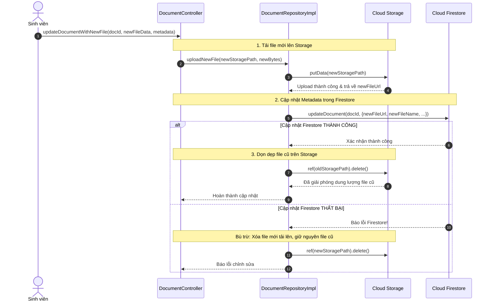
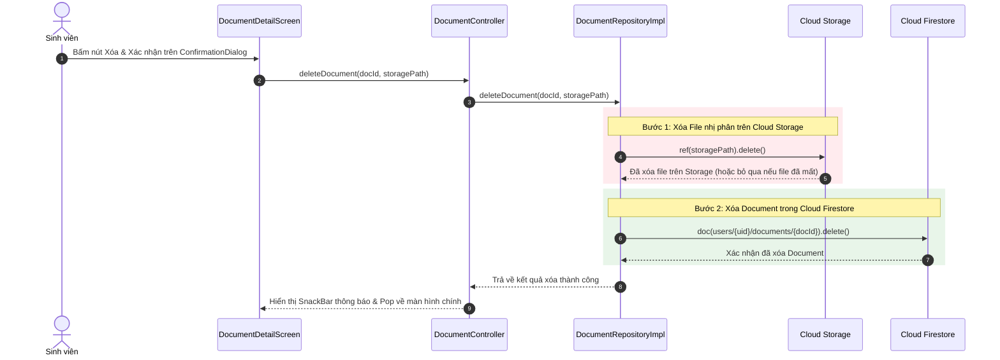
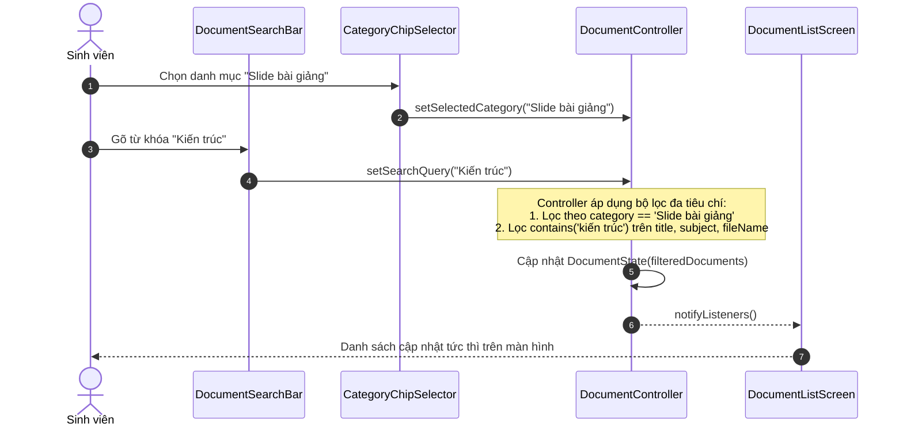
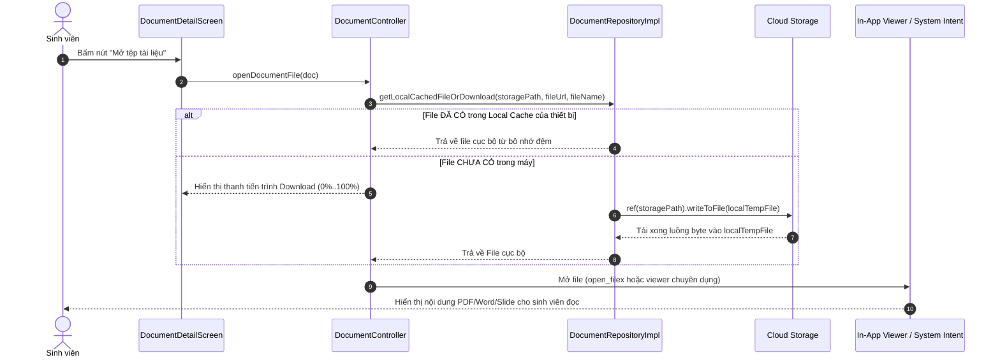
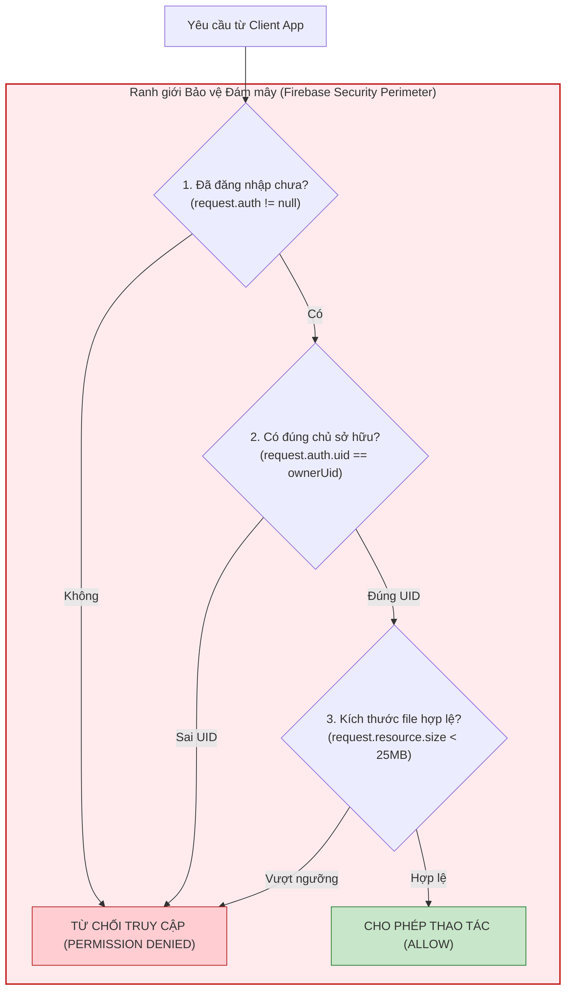

# THIẾT KẾ KIẾN TRÚC TÍCH HỢP CLOUD VÀ LUỒNG DỮ LIỆU
## HỆ THỐNG QUẢN LÝ TÀI LIỆU HỌC TẬP — TÍCH HỢP FIREBASE (CHECKLIST 4)

* **Tên dự án:** Ứng dụng Quản lý Tài liệu Học tập (Document Management System)
* **Học phần:** Thực hành Kiến trúc Phần mềm / Tích hợp Hệ thống Cloud
* **Tài liệu tham chiếu:**
  * [docs/CLOUD_ANALYSIS.md](file:///f:/FlutterProjects/quan_ly_tai_lieu_hoc_tap/docs/CLOUD_ANALYSIS.md) (Checklist 1: Khảo sát hiện trạng)
  * [docs/TRADITIONAL_LIMITATIONS.md](file:///f:/FlutterProjects/quan_ly_tai_lieu_hoc_tap/docs/TRADITIONAL_LIMITATIONS.md) (Checklist 2: Xác định điểm nghẽn)
  * [docs/CLOUD_MODEL_SELECTION.md](file:///f:/FlutterProjects/quan_ly_tai_lieu_hoc_tap/docs/CLOUD_MODEL_SELECTION.md) (Checklist 3: Lựa chọn mô hình và dịch vụ)
* **Người thực hiện:** Nhóm sinh viên thực hiện đề tài (Software Architecture Team)
* **Ngày lập báo cáo:** 09/10/2026
* **Phạm vi thực hiện:** **Chỉ thực hiện Checklist 4** (Thiết kế sơ đồ kiến trúc tích hợp Cloud và mô tả chi tiết các luồng dữ liệu). Tuyệt đối chưa sửa mã nguồn, chưa cài đặt package, chưa tạo `firebase_options.dart`, chưa cấu hình Firebase Console, chưa bật billing.

> [!NOTE]
> **ĐÁNH DẤU TRẠNG THÁI THIẾT KẾ:**  
> Mọi sơ đồ, data model và luồng dữ liệu trong tài liệu này là **BẢN THIẾT KẾ KIẾN TRÚC ĐỀ XUẤT (TO-BE DESIGN)** phục vụ triển khai ở các bước sau. Các thành phần này **CHƯA ĐƯỢC CÀI ĐẶT TRONG SOURCE CODE HIỆN TẠI**.

---

## 1. MỤC TIÊU THIẾT KẾ

1. Chuyển đổi mô hình ứng dụng từ **Cục bộ Đơn người dùng (Standalone Local-First)** sang **Mô hình Đám mây Đa người dùng (Cloud-Integrated Multi-User DMS)**.
2. Thiết kế chi tiết kiến trúc tương lai (TO-BE), phân định ranh giới trách nhiệm (Separation of Concerns) rõ ràng giữa các tầng: Presentation, Business Logic & State, Data Access, và các dịch vụ Cloud của Google Firebase (**Firebase Authentication**, **Cloud Firestore**, **Cloud Storage**).
3. Đưa ra quyết định chuẩn xác về vai trò của **Drift/SQLite hiện có** so với **Cloud Firestore**, tránh tình trạng hai nguồn dữ liệu độc lập gây mâu thuẫn (Split-Brain / Dual-Write).
4. Thiết lập chuẩn hóa Data Model và quy ước đường dẫn phân cấp theo người dùng (`User-Scoped Hierarchy`).
5. Xây dựng sơ đồ tuần tự (Sequence Diagrams) bằng Mermaid cho toàn bộ 7 luồng nghiệp vụ cốt lõi, đặc biệt là các giải pháp kiểm soát lỗi bất đồng bộ và chống rác dữ liệu (Orphan Files).

---

## 2. HIỆN TRẠNG HỆ THỐNG (AS-IS STATE)

Khảo sát thực tế mã nguồn tại [lib/](file:///f:/FlutterProjects/quan_ly_tai_lieu_hoc_tap/lib/) xác nhận:
* **Frontend:** Đã xây dựng hoàn chỉnh giao diện Material 3 với 3 màn hình ([DocumentListScreen](file:///f:/FlutterProjects/quan_ly_tai_lieu_hoc_tap/lib/presentation/screens/document_list_screen.dart), [DocumentDetailScreen](file:///f:/FlutterProjects/quan_ly_tai_lieu_hoc_tap/lib/presentation/screens/document_detail_screen.dart), [DocumentFormScreen](file:///f:/FlutterProjects/quan_ly_tai_lieu_hoc_tap/lib/presentation/screens/document_form_screen.dart)) và các Custom Widgets.
* **Business Logic & State:** Điều phối qua `Provider` + [DocumentController](file:///f:/FlutterProjects/quan_ly_tai_lieu_hoc_tap/lib/logic/controllers/document_controller.dart) (kế thừa `ChangeNotifier`) và [DocumentState](file:///f:/FlutterProjects/quan_ly_tai_lieu_hoc_tap/lib/logic/states/document_state.dart).
* **Data Access & Local Database:** Trừu tượng hóa qua [DocumentRepository](file:///f:/FlutterProjects/quan_ly_tai_lieu_hoc_tap/lib/data/repositories/document_repository.dart) và [DocumentsDao](file:///f:/FlutterProjects/quan_ly_tai_lieu_hoc_tap/lib/data/database/daos/documents_dao.dart), lưu trữ trong SQLite qua Drift ORM (`hoc_tap_documents.sqlite`).
* **Khoảng trống cốt lõi:**
  * Ứng dụng **chưa có xác thực tài khoản** (mọi người dùng đều dùng chung một bộ nhớ máy).
  * Ứng dụng **chưa lưu file nhị phân thực tế** (người dùng nhập text tên file và dung lượng vào form).
  * Dữ liệu **chưa được đồng bộ đám mây**, mất máy là mất toàn bộ dữ liệu.

---

## 3. KIẾN TRÚC ĐỀ XUẤT (TO-BE ARCHITECTURE)

Hệ thống chuyển dịch sang mô hình 4 tầng phân lập, tích hợp các dịch vụ BaaS của Google Firebase:

```text
[ User / Sinh viên ]
         │
         ▼
[ Presentation Layer (Flutter UI) ]
  • AuthScreen (Màn hình đăng nhập Google)
  • DocumentListScreen (Hiển thị danh sách, tìm kiếm, lọc)
  • DocumentDetailScreen (Chi tiết, nút xem/tải file)
  • DocumentFormScreen (Form nhập liệu + Bộ chọn file FilePicker)
         │
         ▼
[ Business Logic & State Layer ]
  • AuthController / AuthState (Quản lý phiên đăng nhập, UID)
  • DocumentController / DocumentState (Điều phối CRUD, upload progress)
         │
         ▼
[ Data Access & Repository Layer ]
  • AuthRepository ───────────► Firebase Authentication (Google Sign-In)
  • DocumentRepository ───────┬► Cloud Firestore (Metadata NoSQL)
                              └► Cloud Storage (File Binary)
                              [+ Local Offline Cache]
```

---

## 4. SƠ ĐỒ KIẾN TRÚC TỔNG THỂ (MERMAID)



---

## 5. MÔ TẢ TRÁCH NHIỆM CHI TIẾT CỦA CÁC THÀNH PHẦN

### 5.1. Presentation Layer (Tầng Giao diện)
* **Xác thực:** Hiển thị nút đăng nhập Google, hiển thị thông tin tài khoản (Avatar, Email, Tên sinh viên) và nút Đăng xuất.
* **Danh sách tài liệu:** Hiển thị thẻ tài liệu với biểu tượng loại file, huy hiệu môn học/danh mục, trạng thái yêu thích.
* **Biểu mẫu:** Tích hợp bộ chọn tệp tin từ máy (`file_picker`), tự động trích xuất tên file, định dạng và kích thước thực tế thay vì bắt người dùng gõ tay.
* **Phản hồi trạng thái:** Hiển thị thanh tiến trình tải lên (Upload Progress Bar: 0% - 100%), trạng thái tải dữ liệu (Loading shimmer/spinner) và thông báo lỗi qua SnackBar.

### 5.2. Business Logic & State Layer (Tầng Nghiệp vụ và Trạng thái)
* **`AuthController`:** Quản lý vòng đời tài khoản (`unauthenticated`, `authenticating`, `authenticated`), lưu thông tin `User` hiện tại và cung cấp `ownerUid` cho toàn bộ ứng dụng.
* **`DocumentController`:**
  * Thẩm định quy tắc nghiệp vụ phía client (Validation Guards: tiêu đề từ 2-200 ký tự, kiểm tra dung lượng file không vượt quá hạn mức cho phép).
  * Điều phối quy trình phức hợp 2 bước: Tải file lên Cloud Storage trước $\to$ Lấy link $\to$ Ghi metadata vào Firestore.
  * Xử lý lỗi tập trung, rollback nếu xảy ra sự cố giữa chừng.

### 5.3. Repository / Data Access Layer (Tầng Truy cập Dữ liệu)
* Đóng vai trò lớp đệm trừu tượng hóa (Abstraction Layer) ngăn không cho Presentation phụ thuộc trực tiếp vào Firebase SDK.
* Triển khai mẫu Repository (`DocumentRepository`): Chịu trách nhiệm gọi SDK `cloud_firestore` và `firebase_storage`, chuyển đổi (mapping) giữa Firestore Document JSON và đối tượng Dart Model strongly-typed.

### 5.4. Firebase Authentication
* Tiếp nhận luồng đăng nhập Google từ thiết bị.
* Xác thực chứng chỉ bảo mật và cấp phát mã định danh duy nhất (`Firebase UID`).
* Tự động làm mới ID Token (Token Refresh) và phát luồng trạng thái qua `authStateChanges()`.

### 5.5. Cloud Firestore
* Lưu trữ toàn bộ thông tin mô tả văn bản (Metadata) của tài liệu.
* Cung cấp cơ chế phát dữ liệu phản ứng thời gian thực thông qua Stream `snapshots()`.

### 5.6. Cloud Storage for Firebase
* Lưu trữ đối tượng tệp nhị phân thực tế (Blob Storage).
* Quản lý upload/download theo luồng byte (Byte Streams) có hỗ trợ tạm dừng, tiếp tục và hủy bỏ.

---

## 6. QUYẾT ĐỊNH KIẾN TRÚC VỀ DRIFT/SQLITE VÀ FIRESTORE

### 6.1. Phân tích 3 phương án lựa chọn

| Phương án xem xét | Ưu điểm | Nhược điểm | Đánh giá tính khả thi |
| :--- | :--- | :--- | :--- |
| **Phương án A: Cloud Firestore là Nguồn chuẩn duy nhất (Single Source of Truth); Tận dụng Cache tích hợp sẵn của Firestore SDK** | • Kiến trúc đồng nhất, rõ ràng.<br/>• SDK Firestore tự động hỗ trợ Offline Persistence (tự lưu cache trên đĩa thiết bị và tự queue thao tác ghi khi mất mạng).<br/>• **Triệt tiêu hoàn toàn rủi ro xung đột dữ liệu (Split-Brain / Dual-Write)**. | • Phải chuyển giao tầng DAO cũ sang Firestore. | **Khuyên dùng tối đa cho Đồ án (LỰA CHỌN CHÍNH THỨC)**. |
| **Phương án B: Firestore là nguồn chuẩn; Tự duy trì Drift/SQLite làm Local Cache thủ công** | • Tận dụng lại bảng SQLite hiện có trong `lib/data/database/`. | • Phát sinh bài toán Cache Invalidation: Khi nào ghi SQLite? Khi nào đọc SQLite?<br/>• Tăng gấp đôi công sức viết code (phải duy trì 2 schema song song). | Không khuyến nghị do làm phức tạp hóa bài tập không cần thiết. |
| **Phương án C: Mô hình Local-First Đồng bộ Hai chiều Đầy đủ (Full Bi-directional Sync Engine)** | • Hoạt động offline hoàn hảo kể cả khi ứng dụng chưa kết nối mạng bao giờ. | • **Cực kỳ phức tạp**: Phải tự viết Conflict Resolution (CRDTs / Vector Clocks), Outbox Pattern.<br/>• Vượt quá phạm vi và thời gian của đồ án sinh viên. | **Bất khả thi trong phạm vi bài tập**. |

### 6.2. Quyết định kiến trúc chính thức
1. **Nguồn dữ liệu chuẩn (Single Source of Truth):** **Cloud Firestore** là nguồn dữ liệu chuẩn mực duy nhất cho toàn bộ Metadata của tài liệu học tập.
2. **Dữ liệu trên Đám mây:** Toàn bộ Metadata nằm trên Firestore; toàn bộ File nhị phân nằm trên Cloud Storage.
3. **Dữ liệu trên Thiết bị:** Sử dụng **Offline Persistence tích hợp sẵn của Cloud Firestore SDK** (sử dụng IndexedDB trên Web và SQLite/LevelDB nội bộ của Firebase trên Native).
4. **Xử lý khi mất mạng (Offline Scenario):**
   * Người dùng vẫn xem được danh sách tài liệu đã được nạp trước đó từ bộ nhớ đệm Firestore.
   * Thao tác thêm/sửa/xóa metadata khi mất mạng sẽ được Firestore SDK đưa vào hàng đợi (Pending Writes) và tự động đồng bộ lên đám mây ngay khi có kết nối trở lại.
   * Riêng thao tác upload/download file mới bắt buộc cần kết nối mạng.
5. **Đối với mã nguồn Drift/SQLite hiện tại:**
   * Giữ nguyên các file trong `lib/data/database/` và bộ test [documents_dao_test.dart](file:///f:/FlutterProjects/quan_ly_tai_lieu_hoc_tap/test/data/documents_dao_test.dart) để chứng minh năng lực kiến trúc Cashew ở bài tập trước.
   * Tầng Repository trong tương lai sẽ chuyển hướng sang triển khai `DocumentFirestoreRepositoryImpl` để phục vụ kết nối Cloud.

---

## 7. THIẾT KẾ DATA MODEL VÀ CẤU TRÚC LƯU TRỮ

### 7.1. Cấu trúc Metadata trong Cloud Firestore
Mỗi tài liệu được biểu diễn bằng một Document NoSQL trong Firestore với cấu trúc phân cấp đề xuất:
👉 **`users/{ownerUid}/documents/{documentId}`**

```json
{
  "id": "doc-uuid-a1b2c3d4",
  "title": "Giáo trình Lập trình Flutter & Dart Nâng cao",
  "description": "Tài liệu học tập phân tầng kiến trúc và tích hợp Firebase Cloud.",
  "subject": "Lập trình Flutter",
  "category": "Giáo trình",
  "fileName": "giao_trinh_flutter_nang_cao.pdf",
  "fileType": "PDF",
  "fileSize": 5242880,
  "storagePath": "users/UID_12345/documents/doc-uuid-a1b2c3d4/giao_trinh_flutter_nang_cao.pdf",
  "fileUrl": "https://firebasestorage.googleapis.com/v0/b/.../o/users%2FUID_12345...",
  "ownerUid": "UID_12345",
  "isFavorite": true,
  "createdAt": "2026-10-09T08:30:00Z",
  "updatedAt": "2026-10-09T09:15:00Z"
}
```

#### Chi tiết các trường:
* `id` *(String)*: Khóa chính UUID (trùng với Firestore Document ID).
* `title` *(String)*: Tiêu đề tài liệu học tập (1..200 ký tự).
* `description` *(String?)*: Mô tả hoặc ghi chú học tập (nullable).
* `subject` *(String)*: Tên môn học.
* `category` *(String)*: Danh mục tài liệu (Giáo trình, Slide, Đề thi...).
* `fileName` *(String)*: Tên tệp tin gốc đính kèm.
* `fileType` *(String)*: Định dạng chuẩn hóa (PDF, DOCX, PPTX, XLSX, ZIP...).
* `fileSize` *(Integer)*: Dung lượng file thực tế tính bằng byte.
* `storagePath` *(String)*: Đường dẫn nội bộ của file trong Cloud Storage Bucket (dùng để xóa hoặc kiểm soát quyền).
* `fileUrl` *(String?)*: Đường dẫn HTTPS công khai có chữ ký số (Download URL) để tải/mở file.
* `ownerUid` *(String)*: Firebase UID của sinh viên sở hữu tài liệu.
* `isFavorite` *(Boolean)*: Đánh dấu tài liệu yêu thích / quan trọng.
* `createdAt` *(Timestamp)*: Thời điểm tạo tài liệu trên hệ thống.
* `updatedAt` *(Timestamp)*: Thời điểm cập nhật tài liệu gần nhất.

### 7.2. Cấu trúc đường dẫn Cloud Storage
👉 **`users/{ownerUid}/documents/{documentId}/{fileName}`**
* **Ưu điểm:**
  1. Phân quyền tuyệt đối: Dễ dàng cấu hình Security Rules để chỉ sinh viên có `request.auth.uid == ownerUid` mới được đọc và ghi vào thư mục của mình.
  2. Tránh trùng lặp tên file: Các file cùng tên của các tài liệu khác nhau hoặc người dùng khác nhau không bao giờ bị ghi đè.
  3. Dọn dẹp tiện lợi: Khi xóa tài liệu, chỉ cần xóa thư mục tương ứng với `documentId`.

---

## 8. SƠ ĐỒ CÁC LUỒNG DỮ LIỆU BẮT BUỘC (SEQUENCE DIAGRAMS)

### 8.1. Luồng A: Đăng nhập Google (Google Sign-In)



---

### 8.2. Luồng B: Tải danh sách tài liệu (Realtime Document Stream)



---

### 8.3. Luồng C: Thêm mới tài liệu và Xử lý chống File Mồ Côi (Upload & Orphan Handling)

> [!IMPORTANT]
> **CHIẾN LƯỢC CHỐNG FILE MỒ CÔI (ORPHAN FILE PREVENTION):**  
> Vì Cloud Storage và Cloud Firestore là hai dịch vụ phân tán độc lập không hỗ trợ giao dịch hai pha (2-Phase Commit / Distributed Transaction), hệ thống phải áp dụng cơ chế **Bù trừ Giao dịch (Compensating Transaction)**: Nếu upload file lên Storage thành công nhưng thao tác ghi Firestore bị lỗi (mất mạng, vi phạm validate), Controller/Repository phải **lập tức phát lệnh xóa file vừa upload trên Storage** để tránh rác dung lượng.



---

### 8.4. Luồng D: Chỉnh sửa tài liệu (Update Document)

Quy trình phân định rõ 2 trường hợp:

#### Trường hợp 1: Chỉ sửa Metadata (Không đổi file)
* Người dùng chỉ sửa tiêu đề, mô tả, môn học, danh mục hoặc trạng thái yêu thích.
* Luồng: UI $\to$ Controller $\to$ Repository $\to$ Gọi trực tiếp `Firestore.update(data)` $\to$ Xong. Không can thiệp Cloud Storage.

#### Trường hợp 2: Thay đổi nội dung tệp đính kèm (Replace File)
* Quy tắc: **Upload file mới trước $\to$ Cập nhật Firestore $\to$ Xóa file cũ sau**. (Đảm bảo nếu upload file mới bị lỗi thì file cũ vẫn còn nguyên vẹn).



---

### 8.5. Luồng E: Xóa tài liệu (Delete Document)



---

### 8.6. Luồng F: Tìm kiếm và Lọc tài liệu (Search & Filtering)

#### Phân tích năng lực của Cloud Firestore:
* **Hạn chế kỹ thuật của Firestore:** Không hỗ trợ truy vấn tìm kiếm chuỗi con chứa toán tử wildcard `LIKE '%query%'` trên nhiều cột như SQLite.
* **Chiến lược áp dụng cho ứng dụng:**
  1. **Lọc đa chiều trên Firestore:** Áp dụng cho các trường có giá trị danh mục rõ ràng:
     * Lọc theo Môn học: `collection.where('subject', isEqualTo: selectedSubject)`
     * Lọc theo Danh mục: `collection.where('category', isEqualTo: selectedCategory)`
     * Sắp xếp: `.orderBy('updatedAt', descending: true)`
  2. **Tìm kiếm từ khóa trong thư viện cá nhân:** Kết hợp **Client-Side In-Memory Filtering** trong lớp `DocumentController`. Vì mỗi sinh viên chỉ quản lý từ vài chục đến vài trăm tài liệu cá nhân, sau khi stream nạp danh sách của user về máy, controller sẽ lọc tức thì bằng hàm `.contains(query.toLowerCase())` trên cả tiêu đề, mô tả, môn học và tên file với độ trễ bằng 0 ms.
  3. **Định hướng mở rộng tương lai:** Nếu mở rộng tìm kiếm toàn văn hàng triệu tài liệu công khai toàn trường, sẽ tích hợp các giải pháp chuyên biệt như Algolia, Typesense hoặc Firebase Extensions Search.



---

### 8.7. Luồng G: Tải xuống và Mở tài liệu (Download & View File)



---

## 9. THIẾT KẾ RANH GIỚI BẢO MẬT Ở MỨC KIẾN TRÚC

Hệ thống tuân thủ nguyên tắc bảo mật **Zero Trust & Least Privilege**:



### Nguyên tắc thiết lập Security Rules (Sẽ triển khai ở Checklist 5):
1. **Firestore Rules:** Chỉ cho phép đọc và ghi vào path `users/{uid}/documents/{docId}` khi `request.auth != null && request.auth.uid == uid`.
2. **Storage Rules:** Chỉ cho phép upload/download tại path `users/{uid}/documents/{docId}/{fileName}` khi `request.auth != null && request.auth.uid == uid`, đồng thời giới hạn dung lượng file không vượt quá 25MB (`request.resource.size < 25 * 1024 * 1024`).
3. **Tuyệt đối không sử dụng quyền đọc/ghi công khai (`allow read, write: if true;`)** ở bất kỳ môi trường nào.

---

## 10. CÁC LỖI TIỀM ẨN VÀ CHIẾN LƯỢC XỬ LÝ (ERROR HANDLING MATRIX)

| Tình huống lỗi | Nguyên nhân kỹ thuật | Hậu quả nếu không xử lý | Giải pháp kiến trúc đề xuất |
| :--- | :--- | :--- | :--- |
| **Mồ côi file (Orphan File)** | Upload file lên Storage thành công nhưng ghi Firestore metadata bị fail. | Lãng phí dung lượng lưu trữ Cloud, file tồn tại nhưng không ai quản lý. | **Compensating Transaction**: Bắt exception ở bước ghi Firestore $\to$ gọi ngay hàm xóa file Storage vừa tạo. |
| **Mất mạng khi đang Upload** | Mất kết nối WiFi/4G giữa chừng khi file lớn đang tải lên. | Treo ứng dụng, dữ liệu dở dang. | Sử dụng `UploadTask` của Firebase Storage với cơ chế bắt lỗi `onException`, hiển thị nút "Thử lại". |
| **Hết hạn Token (Token Expiry)** | Phiên đăng nhập Google hết hạn sau thời gian dài không dùng. | Lỗi `permission-denied` khi gọi Firestore. | Firebase Auth SDK tự động làm mới token ngầm; Controller bắt mã lỗi `unauthenticated` để đưa người dùng về màn hình đăng nhập. |
| **Tải file vượt trần dung lượng** | Sinh viên chọn file video hoặc file nén quá nặng (> 25MB). | Tốn băng thông và chi phí Cloud. | **Phòng vệ 2 lớp**: Kiểm tra kích thước ở Client bằng `file.length()` trước khi upload $\to$ Chặn cứng ở Cloud bằng Storage Rules. |
| **Đứt liên kết khi xóa một phần** | Xóa metadata Firestore thành công nhưng lệnh xóa Storage bị lỗi mạng. | File nhị phân bị kẹt lại trên Cloud bucket. | Thực hiện xóa file Storage trước $\to$ Sau khi xác nhận Storage đã xóa mới xóa Firestore Document. |

---

## 11. KẾT LUẬN

1. Báo cáo kiến trúc này đã giải quyết toàn diện bài toán chuyển đổi hệ thống từ Local-First sang Cloud-Integrated, hoàn toàn khớp với định hướng tại Checklist 6 (Firebase, Google Sign-In, Cloud Storage).
2. Quyết định lựa chọn **Cloud Firestore làm Nguồn chuẩn duy nhất (Single Source of Truth)** kết hợp **Offline Persistence tích hợp của Firestore SDK** là giải pháp tối ưu, loại bỏ hoàn toàn nguy cơ mâu thuẫn dữ liệu đa nguồn mà vẫn giữ vững khả năng hoạt động ngoại tuyến.
3. Toàn bộ 7 luồng dữ liệu nghiệp vụ cốt lõi đã được mô hình hóa bằng sơ đồ Mermaid chi tiết, có cơ chế bù trừ giao dịch để chống rác dữ liệu và ma trận xử lý lỗi phân tán rõ ràng.
4. Đội ngũ kiến trúc đã thiết lập xong nền tảng lý thuyết và bản thiết kế kỹ thuật, hoàn toàn sẵn sàng chuyển tiếp sang các giai đoạn tiếp theo (Thiết lập Bảo mật Checklist 5 và Tích hợp Mã nguồn Checklist 6).
