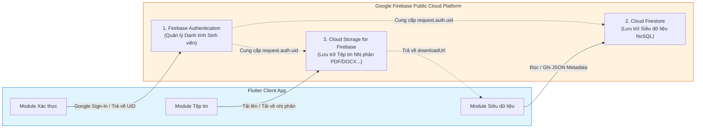

# BÁO CÁO LỰA CHỌN MÔ HÌNH VÀ DỊCH VỤ CLOUD
## THIẾT KẾ GIẢI PHÁP TÍCH HỢP ĐÁM MÂY CHO ỨNG DỤNG QUẢN LÝ TÀI LIỆU HỌC TẬP (CHECKLIST 3)

* **Tên dự án:** Ứng dụng Quản lý Tài liệu Học tập (Document Management System)
* **Học phần:** Thực hành Kiến trúc Phần mềm / Tích hợp Hệ thống Cloud
* **Tài liệu tham chiếu:** [docs/CLOUD_ANALYSIS.md](file:///f:/FlutterProjects/quan_ly_tai_lieu_hoc_tap/docs/CLOUD_ANALYSIS.md), [docs/TRADITIONAL_LIMITATIONS.md](file:///f:/FlutterProjects/quan_ly_tai_lieu_hoc_tap/docs/TRADITIONAL_LIMITATIONS.md)
* **Người thực hiện:** Nhóm sinh viên thực hiện đề tài (Software Architecture Team)
* **Ngày lập báo cáo:** 09/10/2026
* **Phạm vi thực hiện:** **Chỉ thực hiện Checklist 3** (Lựa chọn mô hình triển khai Cloud và các dịch vụ cụ thể). Chưa sửa mã nguồn ứng dụng, chưa cài đặt thêm package, chưa tích hợp Firebase vào source code, chưa yêu cầu kích hoạt billing.

---

## 1. MỤC TIÊU LỰA CHỌN MÔ HÌNH CLOUD

Báo cáo này nhằm thực hiện các mục tiêu kiến trúc cốt lõi sau:
1. Đánh giá toàn diện các mô hình điện toán đám mây (**Public Cloud**, **Private Cloud**, **Hybrid Cloud**) để chọn ra mô hình tối ưu nhất cho bài toán Quản lý Tài liệu Học tập của sinh viên.
2. So sánh khách quan các nhà cung cấp dịch vụ đám mây hàng đầu (**Google Firebase / GCP**, **Amazon Web Services - AWS**, **Microsoft Azure**) dựa trên các tiêu chí: mức độ tương thích với Flutter, độ phức tạp triển khai, quản lý định danh, chi phí và thời gian thực hiện bài tập.
3. Lựa chọn và phân định ranh giới trách nhiệm rõ ràng cho từng dịch vụ đám mây cụ thể (**Authentication**, **Database**, **File Storage**) nhằm giải quyết triệt để 10 điểm nghẽn đã xác minh tại Checklist 2.
4. Đảm bảo giải pháp đề xuất tuân thủ định hướng của đề bài (Checklist 6: tích hợp Firebase, Google Sign-In, lưu trữ tài liệu bằng dịch vụ Firebase) mà vẫn giữ được tính toàn vẹn và khả năng tương thích cao với kiến trúc phân tầng hiện tại của ứng dụng.

---

## 2. BỐI CẢNH CỦA ỨNG DỤNG HIỆN TẠI

Dựa trên kết quả khảo sát từ [docs/CLOUD_ANALYSIS.md](file:///f:/FlutterProjects/quan_ly_tai_lieu_hoc_tap/docs/CLOUD_ANALYSIS.md) và phân tích hạn chế tại [docs/TRADITIONAL_LIMITATIONS.md](file:///f:/FlutterProjects/quan_ly_tai_lieu_hoc_tap/docs/TRADITIONAL_LIMITATIONS.md):
* **Trạng thái hiện tại:** Ứng dụng Flutter được xây dựng theo kiến trúc phân tầng chuẩn mực (Presentation, Business Logic, Data Access, Local Database) kết hợp Drift ORM trên SQLite.
* **Điểm mạnh sẵn có:** Khởi động tức thì, hoạt động mượt mà ngoại tuyến (Offline-First), phản ứng dữ liệu thời gian thực qua Reactive Stream (`watch()`), khóa chính phân tán UUID (v4) sẵn sàng cho môi trường đám mây.
* **Các điểm nghẽn nghiêm trọng cần tháo gỡ:**
  * Dữ liệu bị giam cầm trên thiết bị đơn lẻ (Data Siloing).
  * Chưa có thành phần lưu trữ file nhị phân (PDF/Word/Slide) thực tế; người dùng hiện chỉ nhập text metadata bằng tay.
  * Không có máy chủ, không có cơ chế sao lưu (Backup) và khôi phục (Disaster Recovery).
  * Chưa có hệ thống tài khoản và phân quyền người dùng (Authentication/Authorization).

---

## 3. SO SÁNH BA MÔ HÌNH TRIỂN KHAI CLOUD

Việc lựa chọn mô hình triển khai phải dựa trên đặc thù của ứng dụng di động dành cho học tập, quy mô đồ án sinh viên và nguồn lực vận hành thực tế:

| Tiêu chí so sánh | Public Cloud (Đám mây công cộng) | Private Cloud (Đám mây riêng) | Hybrid Cloud (Đám mây lai truyền thống) |
| :--- | :--- | :--- | :--- |
| **Chi phí đầu tư ban đầu (CapEx)** | **0 VNĐ**: Không mua sắm máy chủ, thiết bị mạng hay ổ cứng SAN/NAS. | **Rất cao**: Phải mua máy chủ vật lý, hệ thống lưu trữ, thiết bị mạng, phòng máy. | **Rất cao**: Cần hạ tầng on-premises kết hợp tài nguyên public cloud. |
| **Chi phí vận hành (OpEx)** | Trả theo mức sử dụng thực tế (Pay-as-you-go). Miễn phí hoàn toàn với hạn mức Free Tier của bài tập. | Rất cao: Tiền điện, làm mát, đường truyền Internet riêng, nhân sự bảo trì 24/7. | Cao: Chi phí duy trì hai môi trường song song và đường truyền chuyên dụng. |
| **Khả năng mở rộng (Scalability)** | **Tự động co giãn (Auto-scaling) tức thì**, gần như vô hạn. | Giới hạn nghiêm ngặt bởi phần cứng vật lý đã trang bị. | Co giãn linh hoạt (Cloud Bursting) nhưng cấu hình đồng bộ phức tạp. |
| **Độ phức tạp triển khai** | **Rất thấp**: Dùng dịch vụ có sẵn (BaaS / Serverless), có SDK chính thức cho client. | **Rất cao**: Phải tự cài OpenStack/K8s, dựng API server, cấu hình SSL/TLS, VPN. | **Cực kỳ cao**: Cấu hình mạng lai (VPN IPsec / Direct Connect), định tuyến phức tạp. |
| **Truy cập từ xa (Remote Access)** | **Toàn cầu, tức thì**: Truy cập an toàn qua Internet mọi lúc mọi nơi. | Hạn chế: Phải mở port modem, cấu hình DDNS hoặc bắt buộc dùng VPN nội bộ. | Truy cập được nhưng đòi hỏi chính sách gateway và firewall phức tạp. |
| **Bảo mật và Phân quyền** | Quản lý bởi các nhà cung cấp hàng đầu thế giới (Google/AWS), tích hợp sẵn IAM, Rules. | Tự chịu trách nhiệm toàn bộ; dễ gặp lỗ hổng nếu sinh viên thiếu kinh nghiệm bảo mật. | Phức tạp trong việc đồng nhất chính sách bảo mật giữa nội bộ và đám mây. |
| **Mức độ phù hợp với Flutter** | **Xuất sắc**: Có các SDK client-side chính thức (FlutterFire, Amplify). | Kém: Sinh viên phải tự viết REST API backend và tự duy trì kết nối WebSocket. | Trung bình: Phải tự quản lý API client kết nối hai nguồn. |
| **Phù hợp với đề bài (Checklist 6)** | **Hoàn toàn phù hợp** (Firebase là giải pháp Public Cloud thuần túy). | **Không phù hợp** (Không thể dùng Firebase thuần on-premises). | Không phù hợp về mặt hạ tầng mạng doanh nghiệp. |

### Giải thích lý do lựa chọn và loại trừ:
* **Loại trừ Private Cloud:** Hoàn toàn bất khả thi cho đồ án sinh viên do đòi hỏi ngân sách phần cứng đắt đỏ, hạ tầng mạng phức tạp và không thể tận dụng hệ sinh thái Firebase theo yêu cầu của đề.
* **Loại trừ Hybrid Cloud theo nghĩa hạ tầng mạng (Enterprise Hybrid):** Việc kết nối máy chủ vật lý riêng với Public Cloud là quá mức cần thiết (over-engineering), gây lãng phí thời gian và làm tăng nguy cơ lỗi hệ thống.
* **LỰA CHỌN: PUBLIC CLOUD (với mô hình Kiến trúc ứng dụng Hybrid Local-Cloud):**
  * Về mặt hạ tầng: Sử dụng 100% tài nguyên **Public Cloud** của Google Firebase.
  * Về mặt kiến trúc phần mềm client: Kết hợp linh hoạt giữa **Local Storage (Drift SQLite hiện có)** làm tầng bộ nhớ đệm ngoại tuyến (Offline Cache) và **Public Cloud Services** làm nguồn chân lý tập trung (Central Single Source of Truth).

---

## 4. SO SÁNH CÁC NHÀ CUNG CẤP DỊCH VỤ ĐÁM MÂY

Để có cái nhìn khách quan ở mức kiến trúc phần mềm, nhóm đã đối chiếu 3 nền tảng đám mây phổ biến nhất hiện nay:

| Tiêu chí đánh giá | Google Firebase / GCP | Amazon Web Services (AWS) | Microsoft Azure |
| :--- | :--- | :--- | :--- |
| **Hệ sinh thái cho Mobile** | **Firebase Platform** (BaaS chuyên biệt hàng đầu cho di động và web). | **AWS Amplify** (Framework đóng gói các dịch vụ AWS cho frontend). | **Azure Mobile Apps** / Dịch vụ rời rạc (Cosmos DB, Blob Storage). |
| **Dịch vụ Xác thực (Auth)** | **Firebase Authentication**: Hỗ trợ Google Sign-In chỉ với vài dòng code; quản lý session tự động. | **Amazon Cognito**: User Pools & Identity Pools; cấu hình phức tạp, nhiều bước phân quyền. | **Microsoft Entra ID / Azure AD B2C**: Phức tạp, hướng tới khách hàng doanh nghiệp. |
| **Dịch vụ Cơ sở dữ liệu** | **Cloud Firestore**: NoSQL realtime document database; cơ chế Reactive Stream đồng điệu với Drift/Flutter. | **Amazon DynamoDB** hoặc **AppSync**: Khá mạnh nhưng mô hình NoSQL yêu cầu thiết kế Single-Table Design phức tạp. | **Azure Cosmos DB**: Chi phí cao; SDK Flutter chưa được hỗ trợ mạnh mẽ bằng cộng đồng. |
| **Dịch vụ Lưu trữ File** | **Cloud Storage for Firebase**: Tích hợp chặt chẽ với Firebase Auth Security Rules; sinh URL tải tức thì. | **Amazon S3**: Tiêu chuẩn vàng lưu trữ đối tượng nhưng cấu hình Bucket Policy và CORS khá rườm rà. | **Azure Blob Storage**: Mạnh mẽ nhưng cấu hình SAS token và phân quyền di động phức tạp hơn. |
| **Mức độ hỗ trợ Flutter** | **Chính thức & Tốt nhất thị trường**: Bộ thư viện `flutterfire` do chính Google bảo trợ; CLI `flutterfire configure` tự động hóa 100%. | Khá tốt qua `amplify_flutter`, nhưng hỗ trợ nền tảng Web còn một số hạn chế. | Kém nhất: Không có SDK cấp cao chính thức tương đương; chủ yếu gọi qua REST API. |
| **Khối lượng công việc** | **Thấp nhất**: Tập trung 100% vào nghiệp vụ ứng dụng, không tốn thời gian dựng máy chủ trung gian. | Trung bình - Cao: Phải cấu hình IAM roles, policies, trigger lambdas. | Cao: Phải tự thiết kế kiến trúc phân tán từ các dịch vụ rời rạc. |
| **Phù hợp với Checklist 6** | **Khớp 100% yêu cầu đề bài** (Firebase + Google Sign-In + Firebase Storage). | Không khớp (Phải xin phép thay đổi đề bài nếu chọn). | Không khớp (Không đáp ứng tiêu chí đề bài). |

### Lợi ích cốt lõi khi thống nhất một hệ sinh thái Firebase:
1. **Bảo mật đồng nhất (Unified Security Context):** Firebase Authentication đóng vai trò là "chìa khóa định danh" dùng chung cho cả Firestore và Storage. Quy tắc bảo mật (`Security Rules`) của cả hai dịch vụ đều có thể truy xuất trực tiếp biến `request.auth.uid` mà không cần thông qua token trung gian hay API Gateway.
2. **Loại bỏ phân mảnh kiến trúc:** Nếu kết hợp Firebase Auth với Amazon S3 và Azure Cosmos DB, ứng dụng sẽ trở thành một hệ thống chắp vá ("Frankenstein architecture"), phát sinh xung đột SDK, tăng kích thước file cài đặt (APK/IPA/Bundle) và gây khó khăn tột độ khi gỡ lỗi (debug).
3. **Độ trễ thấp và tối ưu tài nguyên:** Toàn bộ lưu lượng đều định tuyến trong mạng cáp quang nội bộ của Google Cloud Platform, tối ưu hóa tốc độ tải metadata và tệp tin.

---

## 5. MÔ HÌNH CLOUD ĐƯỢC LỰA CHỌN VÀ CÁC DỊCH VỤ CỤ THỂ

### 5.1. Mô hình triển khai
* **Mô hình:** **Public Cloud (Backend-as-a-Service - BaaS)** do **Google Cloud / Firebase** cung cấp.
* **Chiến lược dữ liệu:** **Hybrid Local-Cloud Data Strategy (Offline-First)** — Kết hợp SQLite/Drift cục bộ trên thiết bị và Firebase trên đám mây.

### 5.2. Các dịch vụ cụ thể và phân định ranh giới trách nhiệm

Hệ thống phân định ranh giới trách nhiệm (Separation of Concerns) rành mạch giữa 3 dịch vụ đám mây:



#### Dịch vụ 1: Firebase Authentication (Xác thực người dùng)
* **Phương thức xác thực:** **Google Sign-In** (`google_sign_in` provider) kết hợp tài khoản email/mật khẩu nếu cần dự phòng.
* **Trách nhiệm duy nhất:**
  * Xác định danh tính duy nhất của sinh viên (`uid`).
  * Quản lý phiên đăng nhập an toàn (ID Token, Refresh Token), tự động duy trì trạng thái đăng nhập qua các lần mở ứng dụng.
  * Cung cấp ngữ cảnh bảo mật (`request.auth`) cho Firestore và Storage.
* **Không làm:** Không lưu thông tin tài liệu hay file học tập.

#### Dịch vụ 2: Cloud Firestore (Cơ sở dữ liệu đám mây cho Siêu dữ liệu)
* **Mô hình dữ liệu:** NoSQL Document-Oriented Database.
* **Cấu trúc lưu trữ:** Collection `documents/` chứa các Document bản ghi tài liệu.
* **Trách nhiệm duy nhất:**
  * Lưu trữ toàn bộ **Siêu dữ liệu (Metadata)**: `id`, `title`, `description`, `subject`, `category`, `fileName`, `fileType`, `fileSize`, `fileUrl` (đường dẫn tải từ Storage), `isFavorite`, `userId` (ID sinh viên sở hữu), `createdAt`, `updatedAt`.
  * Cung cấp cơ chế truy vấn phân loại, sắp xếp và lắng nghe thay đổi thời gian thực qua Stream (`snapshots()`).
* **Ranh giới nghiêm ngặt:** **TUYỆT ĐỐI KHÔNG LƯU NỘI DUNG TỆP NHỊ PHÂN VÀO FIRESTORE**. Giới hạn tối đa của một document Firestore là **1 MiB** (1.048.576 bytes). Việc lưu file nhị phân trực tiếp vào Firestore là vi phạm quy chuẩn thiết kế (anti-pattern), làm lãng phí dung lượng đọc/ghi và gây sập ứng dụng khi file vượt quá 1MB.

#### Dịch vụ 3: Cloud Storage for Firebase (Lưu trữ tệp tin nhị phân)
* **Mô hình lưu trữ:** Object Storage (Google Cloud Storage bucket).
* **Cấu trúc thư mục bucket đề xuất:** `documents/{userId}/{documentId}/{fileName}`.
* **Trách nhiệm duy nhất:**
  * Tiếp nhận, lưu trữ bền vững và phân phối các tệp tin tài liệu nhị phân dung lượng lớn: Giáo trình PDF, Slide PPTX, Đề thi DOCX, Mã nguồn ZIP...
  * Cung cấp URL tải xuống công khai/có ký xác thực (`downloadUrl`) để cập nhật vào trường `fileUrl` của Firestore.
  * Bảo vệ tệp thông qua Storage Security Rules (chỉ chủ sở hữu hoặc người được ủy quyền mới có quyền tải lên/xóa tệp).
* **Không làm:** Không quản lý tìm kiếm hay lọc phân loại danh mục (việc này do Firestore đảm nhiệm).

---

## 6. LÝ DO LỰA CHỌN PHƯƠNG ÁN

1. **Tuân thủ tuyệt đối yêu cầu đề bài:** Giải pháp hiện thực hóa chính xác các chỉ tiêu đặt ra tại Checklist 6 (Firebase, Google Sign-In, Cloud File Storage).
2. **Khả năng tương thích kiến trúc:** Cơ chế Stream thời gian thực của Cloud Firestore (`snapshots()`) có mô hình hoạt động tương đồng 100% với Reactive Stream của Drift ORM (`watch()`) hiện có trong mã nguồn, giúp việc chuyển giao tầng dữ liệu diễn ra mượt mà mà không làm xáo trộn tầng UI.
3. **Giải quyết triệt để 10 điểm nghẽn tại Checklist 2:**
   * Dữ liệu không còn bị cô lập trên một máy (BN-01) nhờ Firestore đồng bộ đa thiết bị.
   * Lấp đầy khoảng trống lưu trữ file thực tế (BN-02, BN-05) nhờ Cloud Storage.
   * Dữ liệu được bảo vệ an toàn trên hạ tầng của Google, loại bỏ rủi ro mất trắng khi gỡ app (BN-03).
   * Có hệ thống định danh người dùng tập trung (BN-04) qua Google Sign-In.
4. **Tối ưu hóa thời gian thực hiện bài tập:** Với công cụ tự động hóa `flutterfire CLI`, thời gian thiết lập hạ tầng giảm từ nhiều tuần (nếu tự dựng server) xuống chỉ còn vài giờ, giúp nhóm tập trung tối đa vào trải nghiệm người dùng và hoàn thiện nghiệp vụ.

---

## 7. HẠN CHẾ VÀ RỦI RO KỸ THUẬT

Dù là giải pháp tối ưu nhất cho bài tập, kiến trúc này vẫn tồn tại một số hạn chế cần kiểm soát:

1. **Phụ thuộc nhà cung cấp (Vendor Lock-in):** Ứng dụng phụ thuộc vào các dịch vụ độc quyền của Google Firebase. Nếu trong tương lai muốn chuyển đổi sang hạ tầng tự quản (Self-hosted), sẽ tốn công sức tái cấu trúc tầng Data Access. *(Giảm thiểu: Nhờ có `DocumentRepository` trừu tượng hóa, tầng UI hoàn toàn độc lập với Firebase SDK).*
2. **Độ trễ và giới hạn kết nối mạng:** Thao tác tải lên (upload) và tải về (download) tài liệu dung lượng lớn (10MB - 50MB) phụ thuộc hoàn toàn vào tốc độ đường truyền Internet của sinh viên.
3. **Nguy cơ phát sinh chi phí nếu truy vấn sai cách:** Mô hình tính phí của Firestore dựa trên số lượt đọc/ghi (Document Reads/Writes). Nếu viết code lắng nghe Stream thiếu kiểm soát hoặc render vòng lặp vô tận, số lượt đọc có thể tăng đột biến.

---

## 8. CHI PHÍ VÀ ĐIỀU KIỆN BILLING CẦN ĐẶC BIỆT LƯU Ý

### 8.1. Chính sách gói cước chính thức của Firebase
Firebase cung cấp hai gói định giá:
* **Gói Spark (Miễn phí):** Hạn mức miễn phí cố định hàng tháng, không yêu cầu thẻ tín dụng.
* **Gói Blaze (Pay-as-you-go):** Trả phí theo mức sử dụng thực tế, **bắt buộc liên kết tài khoản thanh toán quốc tế (Credit/Debit Card)**.

### 8.2. Điều kiện Billing quan trọng đối với Cloud Storage for Firebase
> [!WARNING]
> **LƯU Ý QUAN TRỌNG VỀ ĐIỀU KIỆN BILLING:**  
> Theo chính sách chính thức hiện hành của Google Firebase, việc khởi tạo một Cloud Storage bucket mới trong dự án Firebase yêu cầu dự án phải được nâng cấp lên **gói Blaze**.  
> **Tuy nhiên, khi ở gói Blaze, Google vẫn cung cấp hạn mức miễn phí hàng tháng (Free Tier Allocation) tương đương gói Spark**, cụ thể:
> * **Firebase Authentication:** Miễn phí không giới hạn cho Google Sign-In.
> * **Cloud Firestore:** 1 GiB lưu trữ, 50.000 lượt đọc/ngày, 20.000 lượt ghi/ngày, 20.000 lượt xóa/ngày hoàn toàn miễn phí mỗi tháng.
> * **Cloud Storage:** 5 GiB dung lượng lưu trữ, 1 GiB băng thông tải xuống/ngày, 20.000 lượt upload/ngày miễn phí mỗi tháng.

### 8.3. Cam kết an toàn và khuyến nghị cho Đồ án sinh viên
1. **Tuyệt đối không tự ý bật billing hoặc liên kết thẻ cá nhân** trong quá trình làm bài tập nếu chưa có sự thống nhất và phê duyệt từ giảng viên hướng dẫn hoặc người dùng.
2. **Phương án thay thế an toàn khi kiểm thử nội bộ:** Trong trường hợp không kích hoạt gói Blaze, nhóm có thể:
   * Tích hợp trước Firebase Authentication và Cloud Firestore (hoạt động 100% trên gói Spark miễn phí không cần thẻ).
   * Sử dụng công cụ **Firebase Local Emulator Suite** trên máy tính để giả lập đầy đủ Cloud Storage mà không tốn chi phí và không cần bật billing.

---

## 9. TÍNH TƯƠNG THÍCH VỚI KIẾN TRÚC HIỆN TẠI

Giải pháp lựa chọn không "đập bỏ làm lại" mà kế thừa hoàn hảo kiến trúc hiện có:

```text
[ Presentation Layer (Flutter UI) ]
            │
            ▼
[ Business Logic Layer (DocumentController & DocumentState) ]
            │
            ▼
[ Data Access Layer (DocumentRepository Interface) ]
            │
    ┌───────┴─────────────────────────────────────────┐
    ▼                                                 ▼
[ Local DataSource (Drift SQLite) ]     [ Remote DataSource (Firebase Cloud) ]
  • hoc_tap_documents.sqlite              • Firebase Auth (Google Sign-In)
  • Vai trò: Offline Cache / Zero-latency  • Cloud Firestore (Cloud Metadata)
                                          • Cloud Storage (File Binary)
```

1. **Bảo toàn ranh giới phân tầng:**
   * Tầng Presentation: Các màn hình [document_list_screen.dart](file:///f:/FlutterProjects/quan_ly_tai_lieu_hoc_tap/lib/presentation/screens/document_list_screen.dart) và [document_detail_screen.dart](file:///f:/FlutterProjects/quan_ly_tai_lieu_hoc_tap/lib/presentation/screens/document_detail_screen.dart) tiếp tục giao tiếp qua `DocumentController`.
   * Tầng Business Logic: [document_controller.dart](file:///f:/FlutterProjects/quan_ly_tai_lieu_hoc_tap/lib/logic/controllers/document_controller.dart) giữ nguyên các quy tắc validation và state management, chỉ bổ sung logic điều phối phiên đăng nhập và upload tiến trình.
2. **Phương án xử lý dữ liệu cục bộ (Drift SQLite):**
   * Giữ lại cơ sở dữ liệu Drift SQLite hiện tại để làm tầng **Local Cache**.
   * Khi mở ứng dụng không có mạng: Dữ liệu tải tức thì từ SQLite.
   * Khi có mạng: Đồng bộ hai chiều với Cloud Firestore.
3. **Tránh xung đột dữ liệu:**
   * Quy tắc đồng bộ chi tiết, cơ chế hợp nhất và giải quyết xung đột (Conflict Resolution) sẽ được thiết kế đầy đủ tại **Checklist 4**. Ở giai đoạn hiện tại, hai nguồn dữ liệu được xác định vai trò rõ ràng: **Cloud Firestore là Nguồn Chân lý Trung tâm (Master)**, và **Drift SQLite là Bản đệm Ngoại tuyến (Slave/Cache)**.

---

## 10. BẢNG LỰA CHỌN VÀ GIẢI TRÌNH TỔNG HỢP

Bảng dưới đây tổng hợp các quyết định kỹ thuật được đề xuất cho hệ thống:

| Hạng mục kiến trúc | Phương án được chọn | Lý do lựa chọn | Phương án thay thế đã xem xét | Hạn chế / Lưu ý vận hành | Trạng thái dự án |
| :--- | :--- | :--- | :--- | :--- | :--- |
| **Mô hình Cloud** | **Public Cloud (BaaS)** | Triển khai nhanh, không tốn chi phí phần cứng, tự động co giãn, phù hợp 100% với sinh viên. | Private Cloud, Enterprise Hybrid Cloud | Phụ thuộc vào nhà cung cấp bên thứ ba (Google). | **Quyết định đề xuất** (Checklist 3) |
| **Dịch vụ Xác thực** | **Firebase Authentication (Google Sign-In)** | Tích hợp sâu với Flutter, đáp ứng Checklist 6, bảo mật chuẩn OAuth2, sinh viên không phải nhớ mật khẩu riêng. | Email/Password tự quản, AWS Cognito, Auth0 | Yêu cầu cấu hình SHA-1 fingerprint cho Android và OAuth Client ID cho Web. | **Quyết định đề xuất** (Checklist 3) |
| **Dịch vụ Cơ sở dữ liệu** | **Cloud Firestore** | NoSQL linh hoạt, hỗ trợ realtime stream tương thích với Drift `watch()`, truy vấn nhanh, miễn phí hào phóng. | AWS DynamoDB, Supabase (PostgreSQL), MongoDB Atlas | Giới hạn document 1MB, tính phí theo lượt đọc/ghi, cần tối ưu query. | **Quyết định đề xuất** (Checklist 3) |
| **Dịch vụ Lưu trữ File** | **Cloud Storage for Firebase** | Lưu trữ đối tượng bền vững, phân quyền đồng bộ với Firebase Auth, sinh link tải an toàn, đáp ứng Checklist 6. | Amazon S3, Azure Blob Storage, Cloudinary | Yêu cầu dự án chuyển sang gói Blaze để khởi tạo bucket mới; cần kiểm soát billing. | **Quyết định đề xuất** (Checklist 3) |
| **Xử lý Dữ liệu Cục bộ** | **Giữ Drift SQLite làm Local Cache** | Tận dụng mã nguồn hiện có, giữ vững ưu điểm Offline-First, phản hồi giao diện không độ trễ. | Xóa bỏ SQLite (chỉ dùng Cloud), SharedPreferences, Hive | Cần xây dựng quy tắc đồng bộ và giải quyết xung đột dữ liệu ở Checklist 4. | **Thành phần ĐÃ CÓ trong mã nguồn** |
| **Chọn tệp phía Client** | Package `file_picker` | Cần bổ sung để người dùng chọn tệp thực tế từ bộ nhớ thiết bị thay vì gõ text thủ công. | Tự viết platform channel đọc file | Chưa cài đặt trong `pubspec.yaml`; sẽ triển khai ở các checklist sau. | **Quyết định đề xuất** (Checklist 3) |

---

## 11. KẾT LUẬN

1. Việc lựa chọn **Public Cloud với hệ sinh thái Google Firebase** là quyết định kiến trúc hoàn toàn đúng đắn, khoa học và khả thi nhất đối với đồ án "Ứng dụng Quản lý Tài liệu Học tập".
2. Giải pháp phân định ranh giới trách nhiệm rõ ràng:
   * **Firebase Authentication** quản lý danh tính;
   * **Cloud Firestore** quản lý siêu dữ liệu mô tả;
   * **Cloud Storage** quản lý tệp nhị phân dung lượng lớn;
   * **Drift SQLite** giữ vai trò bộ nhớ đệm ngoại tuyến (Offline Cache).
3. Đã xác định rõ các rào cản về chính sách thanh toán (yêu cầu gói Blaze cho Cloud Storage bucket) và đề ra nguyên tắc an toàn nghiêm ngặt: **Không tự ý bật billing**, sẵn sàng sử dụng Firebase Local Emulator Suite hoặc triển khai thử nghiệm từng phần.
4. Hệ thống hoàn toàn sẵn sàng cho bước tiếp theo: **Thiết kế Kiến trúc Chi tiết và Luồng Dữ liệu Đồng bộ (Checklist 4)**.
