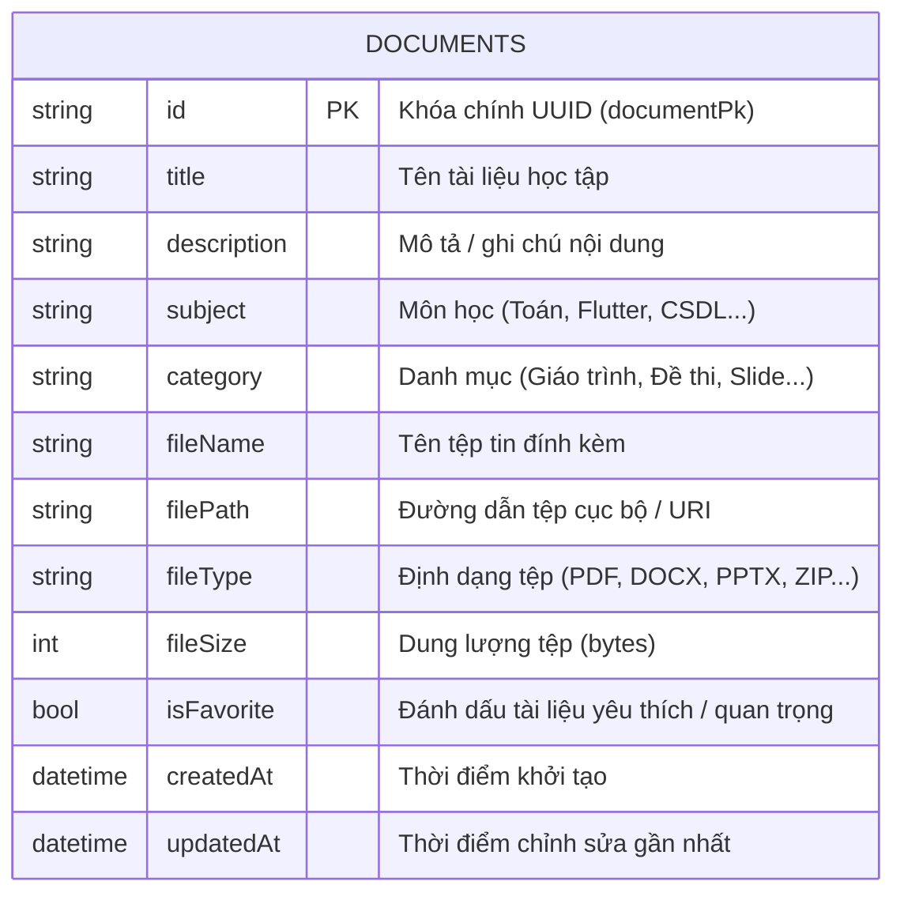

# THIẾT KẾ CƠ SỞ DỮ LIỆU (DATABASE DESIGN SPECIFICATION)

**Dự án:** Ứng dụng Quản lý Tài liệu Học tập theo Kiến trúc Cashew
**Công nghệ:** Drift ORM (Moor) trên SQLite3
**Tài liệu tham chiếu:** `cashew_system_architecture.md`
**Ngày thiết kế:** 03/10/2026

---

## 1. NGUYÊN LÝ THIẾT KẾ (DESIGN PRINCIPLES)

Tuân thủ nguyên lý thiết kế CSDL của Cashew:

1. **Local-First & Offline-First**: Dữ liệu lưu trữ hoàn toàn trên thiết bị thông qua SQLite3 cục bộ.
2. **Khóa chính độc lập phân tán (Decentralized PKs)**: Sử dụng chuỗi UUID (`TextColumn`) làm khóa chính (`id` / `documentPk`) giống như quy ước của Cashew (`walletPk`, `transactionPk`, `categoryPk`), đảm bảo tính duy nhất tuyệt đối khi mở rộng đồng bộ đa thiết bị.
3. **Single Source of Truth (SSOT)**: CSDL SQLite là nơi lưu trữ trạng thái chuẩn mực duy nhất. Mọi truy vấn hiển thị đều đồng bộ từ đây thông qua cơ chế Reactive Query (`watch()`).
4. **Hỗ trợ tìm kiếm & phân loại hiệu năng cao**: Tối ưu hóa truy vấn tìm kiếm theo Tiêu đề (`title`), Môn học (`subject`), Danh mục (`category`) bằng SQL indexing và Pattern Matching (`LIKE %query%`).
5. **Theo dõi vòng đời dữ liệu (Auditing)**: Mỗi bản ghi có mốc thời gian tạo (`createdAt`) và cập nhật (`updatedAt`) để sắp xếp và theo dõi lịch sử.

---

## 2. SƠ ĐỒ THỰC THỂ QUAN HỆ (ERD)



---

## 3. ĐẶC TẢ CHI TIẾT BẢNG `DOCUMENTS`

| Tên trường (Column) | Kiểu dữ liệu Drift | Kiểu SQLite | Ràng buộc (Constraints)    | Ý nghĩa nghiệp vụ                          |
| :------------------ | :----------------- | :---------- | :------------------------- | :----------------------------------------- |
| `id`                | `TextColumn`       | `TEXT`      | `PRIMARY KEY`              | Định danh duy nhất UUID của tài liệu.      |
| `title`             | `TextColumn`       | `TEXT`      | `NOT NULL`, length: 1..200 | Tên tài liệu học tập (bắt buộc).           |
| `description`       | `TextColumn`       | `TEXT`      | `NULLABLE`                 | Mô tả tóm tắt hoặc nội dung ghi chú thêm.  |
| `subject`           | `TextColumn`       | `TEXT`      | `NOT NULL`, length: 1..100 | Tên môn học / học phần liên quan.          |
| `category`          | `TextColumn`       | `TEXT`      | `NOT NULL`, length: 1..100 | Phân loại (Giáo trình, Bài tập, Slide...). |
| `fileName`          | `TextColumn`       | `TEXT`      | `NOT NULL`, length: 1..255 | Tên file vật lý lưu trữ.                   |
| `filePath`          | `TextColumn`       | `TEXT`      | `NULLABLE`                 | Đường dẫn file trên ổ đĩa / bộ nhớ.        |
| `fileType`          | `TextColumn`       | `TEXT`      | `NOT NULL`, length: 1..20  | Đuôi tệp (PDF, DOCX, PPTX, TXT...).        |
| `fileSize`          | `IntColumn`        | `INTEGER`   | `NOT NULL`, default: 0     | Kích thước tệp tính theo Byte.             |
| `isFavorite`        | `BoolColumn`       | `INTEGER`   | `NOT NULL`, default: false | Trạng thái gắn sao ưu tiên.                |
| `createdAt`         | `DateTimeColumn`   | `INTEGER`   | `NOT NULL`, default: now() | Thời gian tạo tài liệu.                    |
| `updatedAt`         | `DateTimeColumn`   | `INTEGER`   | `NOT NULL`, default: now() | Thời gian cập nhật tài liệu gần nhất.      |

### Chỉ mục (Indexes):

Để tăng tốc truy vấn tìm kiếm và lọc danh mục học tập:

- `idx_documents_title`: Tối ưu tìm kiếm theo tên tài liệu.
- `idx_documents_subject`: Tối ưu lọc tài liệu theo môn học.
- `idx_documents_category`: Tối ưu phân loại tài liệu.
- `idx_documents_created_at`: Tối ưu sắp xếp theo thời gian mới nhất.

---

## 4. ĐẶC TẢ DATA ACCESS OBJECT (DAO) - `DocumentsDao`

Theo khuyến nghị cấu trúc mã nguồn của Cashew (mục 8 tài liệu phân tích: Modular hóa CSDL bằng DAOs), toàn bộ nghiệp vụ thao tác SQL được đóng gói trong `DocumentsDao`:

### Các phương thức Reactive Streams:

1. `Stream<List<Document>> watchAllDocuments({String? sortBy, bool ascending = false})`:
   - Lắng nghe luồng dữ liệu toàn bộ tài liệu. Tự động phát ra danh sách mới khi có thao tác INSERT, UPDATE, DELETE.
2. `Stream<List<Document>> watchSearchDocuments(String query, {String? subject, String? category})`:
   - Truy vấn động theo từ khóa `query` trên `title`, `description`, `subject`, `category` và `fileName`.
   - Kết hợp điều kiện lọc chính xác `subject` và `category` nếu có.
   - Trả về Reactive Stream, đảm bảo kết quả tìm kiếm tự cập nhật nếu bản ghi trong kết quả bị chỉnh sửa.

### Các phương thức Thao tác dữ liệu (CRUD Futures):

1. `Future<List<Document>> getAllDocuments()`: Lấy snapshot toàn bộ tài liệu.
2. `Future<Document?> getDocumentById(String id)`: Tìm kiếm tài liệu theo khóa chính UUID.
3. `Future<int> insertDocument(DocumentsCompanion document)`: Thêm tài liệu mới vào SQLite.
4. `Future<bool> updateDocument(DocumentsCompanion document)`: Cập nhật thông tin tài liệu.
5. `Future<int> deleteDocument(String id)`: Xóa tài liệu khỏi CSDL.
6. `Future<List<String>> getAllSubjects()`: Lấy danh sách các môn học phân biệt (DISTINCT).
7. `Future<List<String>> getAllCategories()`: Lấy danh sách các danh mục phân biệt (DISTINCT).

---

## 5. CƠ CHẾ QUẢN LÝ SCHEMA & MIGRATION

- **Phiên bản hiện tại**: `schemaVersion = 1` (khởi tạo bảng `Documents` ban đầu).
- Cơ chế khởi tạo:
  ```dart
  MigrationStrategy get migration => MigrationStrategy(
    onCreate: (Migrator m) async {
      await m.createAll();
    },
    onUpgrade: (Migrator m, int from, int to) async {
      // Sẵn sàng hỗ trợ migration mở rộng các version tiếp theo
    },
  );
  ```
- Kết nối SQLite đa nền tảng:
  - Mobile (Android / iOS): SQLite3 cục bộ thông qua `sqflite` / `sqlite3_flutter_libs` lưu tại thư mục Documents của ứng dụng.
  - Desktop (Windows / macOS / Linux): SQLite3 cục bộ thông qua dynamic library nạp trực tiếp.
  - In-Memory Database: Phục vụ riêng cho Unit Test độc lập không ảnh hưởng đến file CSDL thật.
