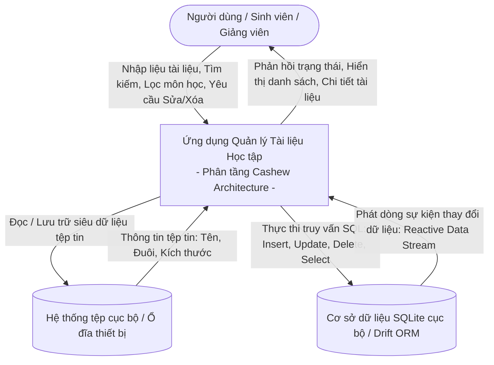
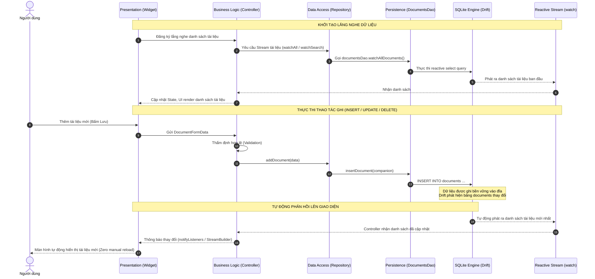

# SƠ ĐỒ LUỒNG DỮ LIỆU (DATA FLOW ARCHITECTURE)

**Dự án:** Ứng dụng Quản lý Tài liệu Học tập theo Kiến trúc Cashew  
**Tài liệu tham chiếu:** `cashew_system_architecture.md`  
**Ngày thiết kế:** 03/10/2026  

---

## 1. SƠ ĐỒ NGỮ CẢNH HỆ THỐNG (SYSTEM CONTEXT DIAGRAM - LEVEL 0)

Sơ đồ ngữ cảnh mô tả tương tác cấp cao nhất giữa Người dùng (Sinh viên / Giảng viên) và Ứng dụng Quản lý Tài liệu Học tập theo triết lý **Local-First**:



---

## 2. BIỂU ĐỒ LUỒNG DỮ LIỆU CHI TIẾT (DFD LEVEL 1)

Biểu đồ mô tả sự di chuyển của dữ liệu qua các tiến trình nghiệp vụ cốt lõi trong ứng dụng:

```mermaid
flowchart TD
    User([Người dùng])

    subgraph Processes ["Tiến trình xử lý nghiệp vụ"]
        P1["1.0 Tiếp nhận & Thẩm định tài liệu<br/>(Validation: Tiêu đề, Môn học, File)"]
        P2["2.0 Quản lý lưu trữ & Truy xuất CSDL<br/>(Drift ORM & DAO)"]
        P3["3.0 Tìm kiếm & Phân loại đa tiêu chí<br/>(Keyword, Subject, Category)"]
        P4["4.0 Xử lý Reactive Stream & Đồng bộ trạng thái<br/>(ChangeNotifier / Provider)"]
    end

    subgraph DataStores ["Kho dữ liệu"]
        D1[("D1: Bảng Documents (SQLite)")]
    end

    User -->|1. Nhập thông tin form| P1
    P1 -->|Dữ liệu hợp lệ| P2
    P2 -->|2. Ghi bản ghi mới / Cập nhật / Xóa| D1

    User -->|3. Nhập từ khóa tìm kiếm / chọn bộ lọc| P3
    P3 -->|Truy vấn lọc dữ liệu| P2
    D1 -.->|Dữ liệu khớp điều kiện| P2

    D1 -.->|4. Kích hoạt trigger thay đổi bảng| P2
    P2 -.->|Reactive Stream watch()| P4
    P4 -->|5. Cập nhật State & Rebuild UI| User
```

---

## 3. LUỒNG DỮ LIỆU PHẢN ỨNG (REACTIVE DATA FLOW - CASHEW CORE PATTERN)

Điểm cốt lõi tạo nên sức mạnh của kiến trúc Cashew là **Database-Driven Reactive State**: Database SQLite là nguồn chân lý duy nhất (Single Source of Truth). Bất cứ thay đổi nào ghi vào SQLite đều tự động kích hoạt Stream cập nhật lên tầng Presentation thông qua StreamProvider/ChangeNotifier mà không cần gọi lại API hay hàm fetch thủ công.



---

## 4. CHI TIẾT CÁC LUỒNG CRUD VÀ TÌM KIẾM

### A. Luồng Thêm mới (Create Flow):
1. **Presentation**: Người dùng nhập thông tin vào `DocumentFormScreen` (Tiêu đề, Môn học, Danh mục, Loại file, Kích thước). Bấm nút "Lưu tài liệu".
2. **Business Logic**: `DocumentController.createDocument()` tiến hành kiểm tra:
   - `title` không được rỗng (bắt buộc tối thiểu 2 ký tự).
   - `subject` không được rỗng.
   - `category` không được rỗng.
   - `fileName` và `fileType` hợp lệ.
   - Nếu dữ liệu không hợp lệ -> trả về lỗi thân thiện và dừng luồng.
3. **Data Access**: `DocumentRepository.addDocument()` chuyển đổi DTO sang `DocumentsCompanion` với khóa chính UUID ngẫu nhiên và `createdAt = now()`.
4. **Persistence**: `DocumentsDao.insertDocument()` thực thi `into(documents).insert(companion)`.
5. **Reactive Callback**: CSDL phát stream -> Giao diện danh sách tự cập nhật -> Giao diện form hiển thị SnackBar thành công và đóng màn hình (`Navigator.pop()`).

### B. Luồng Sửa đổi (Update Flow):
1. **Presentation**: Người dùng chọn "Chỉnh sửa" từ `DocumentDetailScreen` hoặc danh sách -> hiển thị `DocumentFormScreen` với dữ liệu ban đầu.
2. **Business Logic**: Thẩm định dữ liệu chỉnh sửa.
3. **Data Access**: Gọi `DocumentRepository.updateDocument()`, cập nhật trường `updatedAt = now()`.
4. **Persistence**: `DocumentsDao.updateDocument()` thực thi cập nhật theo khóa chính `id`.
5. **Reactive Callback**: Bản ghi thay đổi được phát qua Stream -> Cả màn hình Chi tiết và màn hình Danh sách đều đồng thời cập nhật dữ liệu mới nhất.

### C. Luồng Xóa (Delete Flow):
1. **Presentation**: Người dùng bấm nút "Xóa" trên thẻ tài liệu hoặc màn hình chi tiết.
2. **Presentation (Guard)**: Hiển thị `ConfirmationDialog` cảnh báo thao tác không thể hoàn tác. Nếu người dùng chọn "Hủy" -> dừng luồng.
3. **Business Logic**: Khi xác nhận xóa, `DocumentController.deleteDocument(id)` được gọi.
4. **Data Access & Persistence**: `DocumentsDao.deleteDocument(id)` thực thi `delete(documents).delete()`.
5. **Reactive Callback**: Bảng thay đổi -> Stream phát danh sách mới không còn bản ghi bị xóa -> Thẻ tài liệu biến mất khỏi danh sách ngay lập tức -> Hiển thị SnackBar thông báo thành công.

### D. Luồng Tìm kiếm & Lọc (Search & Filter Flow):
1. **Presentation**: Người dùng nhập từ khóa vào ô tìm kiếm hoặc chọn Chip Môn học / Danh mục.
2. **Business Logic**: `DocumentController.setSearchQuery(query)` / `setSelectedCategory(category)` nhận giá trị. Áp dụng cơ chế Stream mới với tiêu chí lọc hoặc cập nhật Stream filter.
3. **Data Layer Query**: Drift DAO thực thi câu lệnh SQL với mệnh đề `WHERE` tối ưu:
   ```sql
   SELECT * FROM documents
   WHERE (title LIKE '%query%' OR subject LIKE '%query%' OR description LIKE '%query%')
     AND (category = :category OR :category IS NULL)
     AND (subject = :subject OR :subject IS NULL)
   ORDER BY createdAt DESC;
   ```
4. **Reactive Result**: Stream trả về danh sách kết quả lọc. Nếu kết quả rỗng -> UI hiển thị `EmptySearchResultView` gợi ý người dùng đổi từ khóa.
