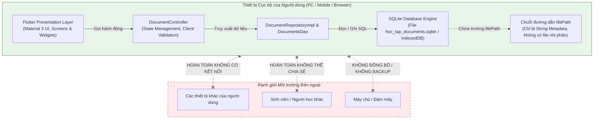

# BÁO CÁO XÁC ĐỊNH ĐIỂM NGHẼN VÀ HẠN CHẾ CỦA HỆ THỐNG HIỆN TẠI
## ĐÁNH GIÁ KHI VẬN HÀNH TRÊN HẠ TẦNG TRUYỀN THỐNG / LOCAL-FIRST (CHECKLIST 2)

* **Tên dự án:** Ứng dụng Quản lý Tài liệu Học tập (Document Management System)
* **Học phần:** Thực hành Kiến trúc Phần mềm / Tích hợp Hệ thống Cloud
* **Đối tượng phân tích:** Mã nguồn và tài liệu khảo sát tại [docs/CLOUD_ANALYSIS.md](file:///f:/FlutterProjects/quan_ly_tai_lieu_hoc_tap/docs/CLOUD_ANALYSIS.md)
* **Người thực hiện:** Nhóm sinh viên thực hiện đề tài
* **Ngày lập báo cáo:** 09/10/2026
* **Phạm vi thực hiện:** **Chỉ thực hiện Checklist 2** (Xác định các điểm nghẽn hoặc hạn chế của hệ thống hiện tại khi vận hành trên hạ tầng truyền thống / cục bộ). Tuyệt đối chưa can thiệp sửa đổi code, chưa thêm dependency, chưa tích hợp Firebase hay cấu hình dịch vụ đám mây.

---

## 1. MỤC TIÊU PHÂN TÍCH

Mục tiêu chính của báo cáo này là:
1. Nhận diện chính xác các rào cản kỹ thuật, điểm nghẽn kiến trúc (architectural bottlenecks) và khoảng trống chức năng (functional gaps) của ứng dụng Quản lý Tài liệu Học tập trong trạng thái hiện tại.
2. Phân loại minh bạch giữa:
   * **Hạn chế đã xác minh từ mã nguồn thực tế (Verified Limitations):** Các hạn chế có bằng chứng trực tiếp trong code, schema hoặc dependency.
   * **Rủi ro kỹ thuật có căn cứ suy luận (Inferred Technical Risks):** Các hệ quả tất yếu khi hệ thống phát triển quy mô hoặc phục vụ nhiều người dùng trên mô hình hiện tại.
   * **Điểm chưa đủ bằng chứng để kết luận (Insufficient Evidence / Unverified):** Các giả định hoặc thông số chưa thể đo lường cụ thể do thiếu dữ liệu môi trường thực tế.
3. Cung cấp cơ sở khoa học và kỹ thuật vững chắc để định hướng chuyển đổi sang kiến trúc Cloud ở các bước tiếp theo.

---

## 2. MÔ TẢ MÔ HÌNH TRIỂN KHAI HIỆN TẠI

Hệ thống hiện tại hoạt động theo mô hình **Độc lập trên Thiết bị Cục bộ (Standalone / Local-First Single-User Application)**:



Đặc điểm vận hành:
* Toàn bộ mã nguồn, logic điều phối và cơ sở dữ liệu đều nằm gói gọn bên trong không gian ứng dụng trên một thiết bị duy nhất.
* Không có sự tham gia của máy chủ từ xa, mạng nội bộ (LAN) hay kết nối Internet.

---

## 3. PHÂN TÍCH HẠN CHẾ THEO 4 THÀNH PHẦN CỐT LÕI

### 3.1. Thành phần Frontend (Giao diện người dùng)

#### A. Phụ thuộc vào một thiết bị và tính khả chuyển dữ liệu
* **Hiện trạng xác minh:** Mã nguồn ứng dụng hỗ trợ đa nền tảng (Native và Web). Tuy nhiên, **dữ liệu hiển thị trên giao diện lại bị cô lập hoàn toàn (data-siloed) theo từng thiết bị**.
* **Hạn chế:** Người dùng nhập tài liệu trên điện thoại thì không thể thấy danh sách tài liệu đó trên máy tính bảng hoặc laptop, dù cùng là tài khoản của một sinh viên (thực tế ứng dụng còn chưa có khái niệm tài khoản).

#### B. Khả năng truy cập từ xa và tính độc lập mạng
* **Hiện trạng xác minh:** Ứng dụng không yêu cầu bất kỳ kết nối mạng nào (`pubspec.yaml` không có `http`, `dio`).
* **Mặt tích cực:** Khởi động tức thì, hoạt động trơn tru ngay cả khi không có mạng (Offline-First).
* **Hạn chế:** Người dùng không có khả năng truy cập tài liệu từ xa thông qua trình duyệt hoặc thiết bị mượn của người khác khi không mang theo thiết bị cá nhân.

#### C. Hạn chế giao diện khi quy mô dữ liệu tăng trưởng
* **Hiện trạng xác minh từ code:** 
  * Tại [document_list_screen.dart](file:///f:/FlutterProjects/quan_ly_tai_lieu_hoc_tap/lib/presentation/screens/document_list_screen.dart#L193-L220), danh sách hiển thị bằng `ListView.builder`.
  * Tại [documents_dao.dart](file:///f:/FlutterProjects/quan_ly_tai_lieu_hoc_tap/lib/data/database/daos/documents_dao.dart#L17-L29), truy vấn `watchAllDocuments` tải toàn bộ danh sách mà không có phân trang (`LIMIT` / `OFFSET`).
* **Hạn chế:** Khi số lượng tài liệu tăng lên hàng nghìn bản ghi, toàn bộ danh sách `List<Document>` được giữ trong bộ nhớ RAM của thiết bị, gây áp lực lên tài nguyên bộ nhớ và có thể gây hiện tượng giật/khựng (jank frame) khi cuộn nhanh trên các thiết bị cấu hình yếu.

#### D. Khả năng hỗ trợ nhiều người dùng và cộng tác
* **Hiện trạng xác minh:** Giao diện chỉ phục vụ cho một cá nhân đơn lẻ trên thiết bị. Không có màn hình đăng nhập, không có hồ sơ sinh viên, không có chức năng xem tài liệu do bạn bè hoặc giảng viên chia sẻ.

---

### 3.2. Thành phần Backend (Phía máy chủ và nghiệp vụ)

#### A. Sự tồn tại của Backend Server
* **Hiện trạng xác minh:** **Ứng dụng hoàn toàn KHÔNG CÓ Backend Server độc lập**. Không có REST API, GraphQL API, hay máy chủ Node.js/Spring Boot/Go/Python nào.
* **Lưu ý kiến trúc:** Lớp `DocumentController` chỉ là controller quản lý trạng thái tại tầng Client (Flutter UI), không phải là Backend Server.

#### B. Vị trí thực thi Business Logic và rủi ro cập nhật
* **Hiện trạng xác minh:** 100% logic thẩm định tính hợp lệ ([document_controller.dart](file:///f:/FlutterProjects/quan_ly_tai_lieu_hoc_tap/lib/logic/controllers/document_controller.dart#L113-L153)) và logic xử lý dữ liệu chạy trực tiếp trên thiết bị của người dùng (Client-Side).
* **Hạn chế & Rủi ro suy luận:** 
  * **Khó cập nhật quy tắc nghiệp vụ:** Nếu nhà trường hoặc môn học cập nhật danh mục, quy chuẩn đặt tên file hoặc quy tắc phân loại, bắt buộc phải phát hành bản build ứng dụng mới và yêu cầu người dùng cập nhật phần mềm.
  * **Thiếu cơ chế xác thực tập trung:** Bất kỳ ai can thiệp được vào file SQLite trên thiết bị đã root/jailbreak hoặc trình duyệt Web đều có thể sửa đổi dữ liệu mà không qua bất kỳ lớp kiểm duyệt bảo mật tập trung nào.

#### C. Khả năng quản lý nhiều người dùng và mở rộng hệ thống
* **Hiện trạng xác minh:** Không có hệ thống Identity Provider (IdP), không có bảng quản lý User/Account, không có phân quyền (RBAC: Admin, Giảng viên, Sinh viên).
* **Hạn chế:** Không thể biến ứng dụng thành một hệ sinh thái học tập chia sẻ chung cho nhiều người nếu không xây dựng thêm tầng Backend Server hoặc tích hợp dịch vụ BaaS (Backend-as-a-Service).

---

### 3.3. Thành phần Database (Cơ sở dữ liệu)

#### A. Nơi lưu trữ và tính phân tán
* **Hiện trạng xác minh:**
  * Native: Lưu tại `File(p.join(dbFolder.path, 'hoc_tap_documents.sqlite'))` ([native.dart](file:///f:/FlutterProjects/quan_ly_tai_lieu_hoc_tap/lib/data/database/connection/native.dart)).
  * Web: Lưu tại `WasmDatabase.open(databaseName: 'hoc_tap_documents')` trên IndexedDB ([web.dart](file:///f:/FlutterProjects/quan_ly_tai_lieu_hoc_tap/lib/data/database/connection/web.dart)).
* **Hạn chế:** Dữ liệu hoàn toàn phân mảnh, nằm cục bộ trên bộ nhớ vật lý của một thiết bị duy nhất.

#### B. Cơ chế sao lưu (Backup) và phục hồi thảm họa (Disaster Recovery)
* **Hiện trạng xác minh:** Trong mã nguồn **hoàn toàn không có tính năng sao lưu (Export/Backup)** và **khôi phục (Import/Restore)**.
* **Hạn chế nghiêm trọng:**
  * Nếu người dùng gỡ cài đặt ứng dụng (Uninstall), xóa dữ liệu ứng dụng (Clear Data), hoặc làm mất/hỏng thiết bị: **Toàn bộ dữ liệu tài liệu học tập bị xóa sạch vĩnh viễn**.
  * Trên nền tảng Web: Nếu người dùng xóa lịch sử duyệt web hoặc trình duyệt tự động dọn dẹp IndexedDB khi thiếu dung lượng ổ đĩa, cơ sở dữ liệu sẽ biến mất không thể phục hồi.

#### C. Cơ chế đồng bộ và giải quyết xung đột (Conflict Resolution)
* **Hiện trạng xác minh:** Không có cơ chế đồng bộ (Sync Engine).
* **Hạn chế:** Không thể tự động hợp nhất dữ liệu nếu người dùng sử dụng đồng thời máy tính và điện thoại. Nếu cố gắng sao chép thủ công file SQLite giữa hai máy, nguy cơ ghi đè dữ liệu (Data Overwrite / Lost Updates) là 100%.

#### D. Hiệu năng tìm kiếm và mở rộng dữ liệu
* **Hiện trạng xác minh:** Cơ chế tìm kiếm trong [documents_dao.dart](file:///f:/FlutterProjects/quan_ly_tai_lieu_hoc_tap/lib/data/database/daos/documents_dao.dart#L46-L52) sử dụng toán tử SQL `LIKE %pattern%` ghép OR trên 5 cột:
  ```dart
  tbl.title.like(pattern) |
  tbl.subject.like(pattern) |
  tbl.category.like(pattern) |
  tbl.fileName.like(pattern) |
  tbl.description.like(pattern)
  ```
* **Hạn chế kỹ thuật:** Cú pháp `LIKE %...%` không thể tận dụng B-Tree Index tiêu chuẩn của SQLite, buộc database engine phải quét tuần tự toàn bộ bảng (Full Table Scan). Chưa tích hợp SQLite Full-Text Search (FTS5). Mặc dù với số lượng tài liệu nhỏ (vài chục đến vài trăm) tốc độ vẫn tức thì, nhưng khi số lượng tài liệu lên tới hàng chục nghìn bản ghi thì tốc độ tìm kiếm sẽ suy giảm rõ rệt.

---

### 3.4. Thành phần File Storage (Lưu trữ tệp tin)

#### A. Khoảng trống chức năng lưu trữ tệp nhị phân
* **Hiện trạng xác minh:** 
  * Bảng `Documents` chỉ lưu các trường văn bản: `fileName` (TEXT), `filePath` (TEXT), `fileType` (TEXT), `fileSize` (INTEGER).
  * Trong [document_form_screen.dart](file:///f:/FlutterProjects/quan_ly_tai_lieu_hoc_tap/lib/presentation/screens/document_form_screen.dart), các trường tên tệp, đường dẫn và dung lượng đều do người dùng **nhập thủ công bằng bàn phím**.
  * Hoàn toàn không có code đọc/ghi mảng byte (`Uint8List`), không có `file_picker`.
* **Hạn chế cốt lõi:** **Ứng dụng hiện tại chưa có File Storage thực tế**, mà chỉ là hệ thống quản lý siêu dữ liệu (Metadata).

#### B. Rủi ro đứt gãy liên kết tệp (Broken File References / Dangling Pointers)
* **Hiện trạng xác minh:** Trường `filePath` lưu chuỗi đường dẫn cục bộ (ví dụ: `/docs/flutter/giao_trinh_flutter.pdf` hoặc đường dẫn tuyệt đối trên máy tính).
* **Rủi ro kỹ thuật:**
  * Nếu người dùng di chuyển tệp, đổi tên tệp hoặc xóa tệp từ trình quản lý tệp của hệ điều hành ngoài ứng dụng, chuỗi `filePath` trong ứng dụng sẽ trỏ vào một đường dẫn không tồn tại (Dead Link).
  * Ứng dụng không có cơ chế quản lý vòng đời tệp (File Lifecycle Management), không kiểm tra xem tệp tại `filePath` còn tồn tại hay không trước khi hiển thị.

#### C. Chia sẻ và bảo mật quyền truy cập tệp
* **Hiện trạng xác minh:** Không có tính năng tạo link chia sẻ, không có quyền truy cập (Read/Write/Share), không có mã hóa tệp tin lưu trữ.

---

## 4. BẢNG TỔNG HỢP CÁC ĐIỂM NGHẼN VÀ HẠN CHẾ

Bảng dưới đây tổng hợp chi tiết các điểm nghẽn, phân định rõ trạng thái xác minh và mức độ ưu tiên giải quyết:

| ID | Thành phần | Hạn chế cụ thể | Bằng chứng mã nguồn thực tế | Nguyên nhân gốc rễ | Tác động thực tế | Mức độ ưu tiên | Trạng thái xác minh |
| :--- | :--- | :--- | :--- | :--- | :--- | :--- | :--- |
| **BN-01** | **Database** | Dữ liệu bị cô lập hoàn toàn trên từng thiết bị (Siloed Data) | [native.dart](file:///f:/FlutterProjects/quan_ly_tai_lieu_hoc_tap/lib/data/database/connection/native.dart#L13) lưu file SQLite trong thư mục Documents cục bộ | Kiến trúc Standalone Local-First, chưa có Remote Database | Người dùng đổi máy hoặc dùng nhiều thiết bị không thể truy cập dữ liệu cũ | **Cao** | **Đã xác minh** |
| **BN-02** | **File Storage** | Chưa lưu trữ file nhị phân thực tế, chỉ quản lý metadata chuỗi | [document_form_screen.dart](file:///f:/FlutterProjects/quan_ly_tai_lieu_hoc_tap/lib/presentation/screens/document_form_screen.dart#L28-L29) cho nhập tay text; không có `file_picker` trong `pubspec.yaml` | Chưa triển khai module File Storage và File Picker | Người dùng không thể mở đọc, xem trước hay tải tài liệu học tập | **Cao** | **Đã xác minh** |
| **BN-03** | **Database** | Nguy cơ mất trắng toàn bộ dữ liệu do không có Backup/Restore | Mã nguồn không có hàm export/import SQLite hay đẩy lên cloud | Phụ thuộc hoàn toàn vào độ bền của ổ cứng thiết bị cục bộ | Gỡ ứng dụng hoặc hỏng máy là mất toàn bộ danh mục tài liệu | **Cao** | **Đã xác minh** |
| **BN-04** | **Backend** | Thiếu Backend Server và tầng xác thực/phân quyền tập trung | `pubspec.yaml` không có `http`/`dio`/`firebase_auth`; không có source code server | Chưa có tầng máy chủ trung gian | Không hỗ trợ môi trường nhiều người dùng, không phân quyền sinh viên / giảng viên | **Cao** | **Đã xác minh** |
| **BN-05** | **File Storage** | Nguy cơ đứt gãy liên kết tệp (Broken Reference) | Cột `filePath` trong [documents_table.dart](file:///f:/FlutterProjects/quan_ly_tai_lieu_hoc_tap/lib/data/database/tables/documents_table.dart#L27) là chuỗi văn bản tự do | Lưu đường dẫn tĩnh mà không quản lý file trong sandbox hay cloud bucket | Đường dẫn trở nên vô nghĩa khi di chuyển file hoặc đổi máy | **Trung bình** | **Đã xác minh** |
| **BN-06** | **Frontend** | Toàn bộ danh sách tải vào RAM không phân trang (Pagination) | [documents_dao.dart](file:///f:/FlutterProjects/quan_ly_tai_lieu_hoc_tap/lib/data/database/daos/documents_dao.dart#L21) `select(documents).watch()` không có limit/offset | Chưa áp dụng Lazy Loading / Pagination ở tầng truy vấn và UI | Nguy cơ tốn bộ nhớ và giật lag giao diện khi tài liệu đạt số lượng lớn | **Trung bình** | **Đã xác minh** |
| **BN-07** | **Database** | Tìm kiếm bằng `LIKE %query%` trên 5 cột gây Full Table Scan | [documents_dao.dart](file:///f:/FlutterProjects/quan_ly_tai_lieu_hoc_tap/lib/data/database/daos/documents_dao.dart#L46-L52) sử dụng toán tử `.like('%...%')` | Chưa thiết lập bảng ảo FTS (Full-Text Search) trong Drift | Hiệu năng tìm kiếm có thể suy giảm khi dữ liệu phình to | **Thấp** | **Rủi ro suy luận** |
| **BN-08** | **Backend** | Khó cập nhật quy tắc nghiệp vụ tập trung | Validation logic nằm hoàn toàn trong [document_controller.dart](file:///f:/FlutterProjects/quan_ly_tai_lieu_hoc_tap/lib/logic/controllers/document_controller.dart#L113-L153) | Toàn bộ logic chạy ở Client | Phải cập nhật lại app mỗi khi muốn đổi quy chuẩn quản lý tài liệu | **Thấp** | **Rủi ro suy luận** |
| **BN-09** | **Database** | Nguy cơ xung đột dữ liệu (Write Conflict) nếu kết nối đồng bộ thủ công | Khóa chính là UUID (`id`), nhưng không có trường version/vector clock | Chưa thiết kế schema hỗ trợ đồng bộ đa chiều (Multi-master Sync) | Nguy cơ ghi đè dữ liệu nếu sau này mở tính năng đồng bộ | **Trung bình** | **Rủi ro suy luận** |
| **BN-10** | **Hạ tầng** | Tốc độ truy vấn và giới hạn dung lượng lưu trữ trên thiết bị yếu | Chưa có số liệu benchmark thực tế trên nhiều dòng máy | Giới hạn phần cứng của từng loại thiết bị cá nhân | Chưa đủ dữ liệu đo lường cụ thể về giới hạn phần cứng | **Thấp** | **Chưa đủ dữ liệu** |

---

## 5. GIẢI THÍCH LÝ DO PHÂN CẤP MỨC ĐỘ ƯU TIÊN

* **Mức độ Cao (Critical / High):**
  * Bao gồm các mã **BN-01, BN-02, BN-03, BN-04**.
  * **Lý do:** Đây là các rào cản mang tính "sống còn" đối với một hệ thống Quản lý Tài liệu Học tập hiện đại. Việc không có file nhị phân (BN-02), dữ liệu bị giam cầm trên 1 máy (BN-01), nguy cơ mất trắng dữ liệu không thể phục hồi (BN-03) và không có xác thực người dùng (BN-04) làm triệt tiêu khả năng ứng dụng thực tế trong môi trường giáo dục số (nơi sinh viên cần đọc tài liệu trên cả điện thoại và máy tính, cần lưu trữ an toàn và chia sẻ trong nhóm học tập).
* **Mức độ Trung bình (Medium):**
  * Bao gồm các mã **BN-05, BN-06, BN-09**.
  * **Lý do:** Ảnh hưởng trực tiếp đến độ ổn định, trải nghiệm mượt mà của giao diện và tính toàn vẹn dữ liệu khi quy mô dữ liệu mở rộng ở mức vừa phải (hàng trăm đến hàng nghìn tài liệu). Cần được giải quyết khi tái cấu trúc kiến trúc nhưng không cản trở việc demo các luồng cơ bản.
* **Mức độ Thấp (Low):**
  * Bao gồm các mã **BN-07, BN-08, BN-10**.
  * **Lý do:** Các điểm này thuộc về tối ưu hóa nâng cao (Full-Text Search, Remote Config, Benchmark thiết bị yếu). Ở quy mô sử dụng thông thường hiện tại, SQLite vẫn xử lý `LIKE` rất nhanh trên tập dữ liệu nhỏ dưới 1.000 bản ghi.

---

## 6. PHÂN TÍCH TÁC ĐỘNG TOÀN DIỆN CỦA CÁC ĐIỂM NGHẼN

### 6.1. Tác động đến Trải nghiệm Người dùng (UX)
* **Trải nghiệm đứt đoạn:** Sinh viên tìm thấy tài liệu trong ứng dụng nhưng bấm vào chỉ thấy thông tin mô tả văn bản, không thể mở tài liệu ra đọc nội dung (do chưa có file thực tế).
* **Thất vọng khi chuyển đổi thiết bị:** Khi sinh viên ngồi học ở thư viện bằng laptop, họ không tìm thấy các tài liệu quan trọng mà mình đã dày công ghi chú và lưu trữ trên điện thoại vào tối hôm trước.
* **Nhập liệu thủ công rườm rà:** Người dùng phải tự gõ tên tệp, tự ước lượng dung lượng KB thay vì được hệ thống tự động trích xuất thông tin khi chọn tệp từ máy.

### 6.2. Tác động đến Khả năng Truy cập Từ xa (Remote Access)
* **Tính khả dụng từ xa bằng 0 (Zero Remote Availability):** Toàn bộ dữ liệu nằm cục bộ. Người dùng hoàn toàn không có cách nào truy cập vào kho tài liệu nếu không trực tiếp cầm thiết bị đã cài đặt ứng dụng trên tay.

### 6.3. Tác động đến An toàn và Toàn vẹn Dữ liệu (Data Safety & Integrity)
* **Điểm lỗi đơn lẻ cục bộ (Single Point of Failure):** Chiếc điện thoại hoặc máy tính cá nhân trở thành điểm lỗi duy nhất. Mọi sự cố vật lý (máy rơi vỡ, nhiễm virus, hỏng ổ cứng, gỡ nhầm ứng dụng) đồng nghĩa với việc toàn bộ dữ liệu học tập bị tiêu hủy không dấu vết.
* **Đứt gãy liên kết (Dangling Pointers):** Lưu đường dẫn chuỗi tĩnh khiến dữ liệu trong CSDL mất đồng bộ với trạng thái tệp thực tế ngoài hệ điều hành.

### 6.4. Tác động đến Khả năng Cộng tác (Collaboration)
* **Ứng dụng bị "cô lập" xã hội:** Học tập là một quá trình mang tính tập thể cao (học nhóm, chia sẻ slide, trao đổi đề thi). Kiến trúc hiện tại biến mỗi cài đặt thành một "hòn đảo biệt lập", không có bất kỳ khả năng nào để chia sẻ tài liệu hay cộng tác giữa các sinh viên cùng môn học.

### 6.5. Tác động đến Bảo trì và Vận hành (Maintenance & Operations)
* **Khó khăn trong hỗ trợ người dùng:** Vì không có log tập trung và không có cơ sở dữ liệu trên server, nếu người dùng gặp lỗi dữ liệu (data corruption) cục bộ, đội ngũ kỹ thuật không thể hỗ trợ chẩn đoán hay khôi phục dữ liệu từ xa.
* **Chi phí cập nhật cao:** Bất kỳ thay đổi nào trong cấu trúc dữ liệu đều phải dựa vào migration cục bộ của Drift trên thiết bị người dùng, tiềm ẩn rủi ro lỗi migration nếu người dùng nâng cấp từ các phiên bản quá cũ.

### 6.6. Tác động đến Khả năng Mở rộng Hệ thống (Scalability)
* **Không thể mở rộng theo chiều ngang (Horizontal Scalability):** Hệ thống hiện tại không có khái niệm máy chủ nên không thể scale theo số lượng người dùng.
* **Tắc nghẽn bộ nhớ:** Truy vấn tải trọn gói toàn bộ dữ liệu vào state của Flutter sẽ gặp trần giới hạn bộ nhớ (RAM Out-Of-Memory) nếu người dùng có hàng chục nghìn tài liệu.

---

## 7. KẾT LUẬN VỀ NHU CẦU CHUYỂN ĐỔI SANG MÔ HÌNH CLOUD

Từ các phân tích khoa học và bằng chứng mã nguồn ở trên, việc duy trì hệ thống theo mô hình truyền thống cục bộ bộc lộ những hạn chế nghiêm ngặt không thể vượt qua:

1. **Khoảng trống chức năng lớn nhất:** Ứng dụng mới chỉ dừng lại ở việc quản lý **Siêu dữ liệu (Metadata)** chứ chưa thực sự là một hệ thống **Quản lý Tài liệu (DMS)** đúng nghĩa do thiếu thành phần lưu trữ tệp vật lý.
2. **Nhu cầu cấp thiết về Đám mây (Cloud Necessity):**
   * Cần một giải pháp **Cloud Database** để tập trung hóa dữ liệu, kích hoạt khả năng đồng bộ xuyên suốt đa thiết bị (Cross-device Sync) và bảo vệ dữ liệu bằng cơ chế sao lưu tự động.
   * Cần một giải pháp **Cloud Storage** để tiếp nhận, lưu trữ an toàn và phân phối các tệp tin tài liệu nhị phân (PDF, Word, Slide...) kèm đường dẫn truy cập bền vững (Download URL).
   * Cần một giải pháp **Cloud Identity / Authentication** để phân định quyền sở hữu tài liệu theo từng sinh viên và hỗ trợ chia sẻ cộng tác an toàn.
3. **Định hướng kiến trúc tối ưu:**
   * Thay vì đập bỏ hoàn toàn mã nguồn hiện tại, kiến trúc **Hybrid Local-First + Cloud Sync** (ví dụ tích hợp Firebase Firestore / Firebase Storage với Drift SQLite làm tầng Local Cache) là phương án lý tưởng nhất: Vừa giữ được ưu điểm phản hồi tức thì và hoạt động offline của hệ thống hiện tại, vừa giải quyết triệt để tất cả 10 điểm nghẽn đã xác định.
