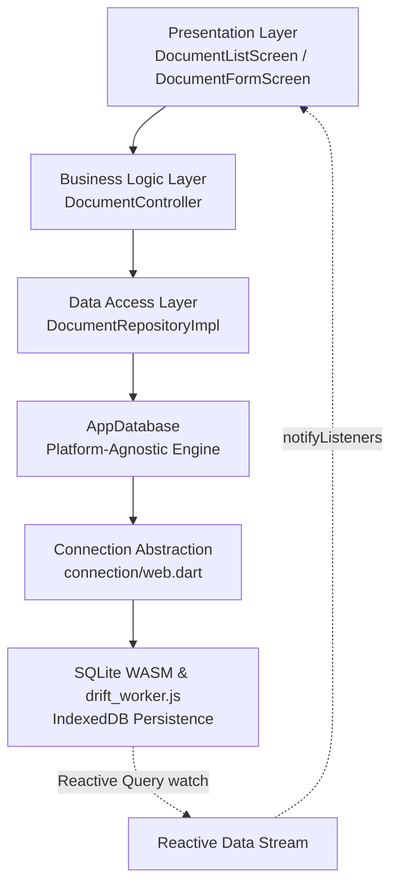

# BÁO CÁO GIẢI PHÁP HỖ TRỢ GOOGLE CHROME & FLUTTER WEB (WEB SUPPORT)

**Dự án:** Ứng dụng Quản lý Tài liệu Học tập theo Kiến trúc Cashew  
**Thời gian thực hiện:** 03/10/2026  
**Nền tảng hỗ trợ:** Web (Google Chrome, Edge, Safari, Firefox) & Native (Android, Windows, macOS, Linux, iOS)  
**Công nghệ lưu trữ Web:** Drift WasmDatabase + SQLite3 WebAssembly (`sqlite3.wasm`) + Web Worker (`drift_worker.js`) với IndexedDB  

---

## 1. MÔ TẢ LỖI BAN ĐẦU (ORIGINAL ERROR)

Khi thực thi lệnh khởi chạy trên nền tảng Web:
```bash
flutter run -d chrome
```
hoặc
```bash
flutter build web
```
Trình biên dịch Dart Web (`dart2js` / `dart2wasm`) lập tức dừng và báo lỗi nghiêm trọng:
```text
"Dart library 'dart:ffi' is not available on this platform."
```
kèm theo hàng loạt lỗi biên dịch từ các gói phụ thuộc cấp thấp:
- `package:sqlite3/src/ffi/libsqlite3.g.dart` (Lỗi `Only JS interop members may be 'external'`)
- `package:sqlite3/src/ffi/bindings.dart`
- `package:ffi/src/allocation.dart`

---

## 2. NGUYÊN NHÂN GỐC RỄ (ROOT CAUSE ANALYSIS)

1. **Bản chất của `dart:ffi`**:
   - `dart:ffi` (Foreign Function Interface) là thư viện nội tại của Dart VM cho phép mã Dart gọi trực tiếp các hàm C/C++ được biên dịch thành thư viện động native (`.dll` trên Windows, `.so` trên Android/Linux, `.dylib` trên macOS).
   - Thư viện này thao tác trực tiếp với con trỏ bộ nhớ vật lý (`Pointer`), cấp phát bộ nhớ cấp thấp (`posixMalloc`, `posixFree`), các hàm `external` liên kết C-ABI.
2. **Hạn chế bảo mật của trình duyệt (Browser Sandbox)**:
   - Trong môi trường trình duyệt Web, JavaScript engine chạy trong một sandbox cô lập nghiêm ngặt, không cho phép truy cập trực tiếp vào không gian địa chỉ bộ nhớ của hệ điều hành.
   - Do đó, **`dart:ffi` hoàn toàn không tồn tại trên nền tảng Web**.
3. **Nguyên nhân kích hoạt lỗi trong dự án**:
   - Tệp [app_database.dart](file:///f:/FlutterProjects/quan_ly_tai_lieu_hoc_tap/lib/data/database/app_database.dart) trước đây import trực tiếp `package:drift/native.dart`, `dart:io`, và `package:path_provider/path_provider.dart`.
   - `package:drift/native.dart` phụ thuộc trực tiếp vào `package:sqlite3/sqlite3.dart`, từ đó kéo theo `package:ffi` và `dart:ffi`.
   - Khi [main.dart](file:///f:/FlutterProjects/quan_ly_tai_lieu_hoc_tap/lib/main.dart) nạp [AppDatabase](file:///f:/FlutterProjects/quan_ly_tai_lieu_hoc_tap/lib/data/database/app_database.dart), toàn bộ cây import tĩnh bị gom vào quá trình biên dịch cho Web, dẫn đến lỗi biên dịch thất bại.

---

## 3. GIẢI PHÁP KIẾN TRÚC: TÁCH NATIVE VÀ WEB DATABASE

Theo đúng tư tưởng kiến trúc của **Cashew** (Mục 2 và 3 trong tài liệu `cashew_system_architecture.md`: Trừu tượng hóa nền tảng qua `platform abstraction`), chúng tôi áp dụng cơ chế **Conditional Imports / Exports** để tách biệt hoàn toàn cài đặt CSDL Native và Web.

### Sơ đồ Luồng Hoạt động trên Web:



---

## 4. CHI TIẾT CẤU HÌNH DRIFT WEB / WASM

Để SQLite hoạt động trơn tru trên trình duyệt mà vẫn giữ nguyên 100% tính năng Reactive Streams (`watch()`), chúng tôi triển khai hệ thống tệp và cấu hình như sau:

### A. Tệp tài nguyên SQLite WASM trong thư mục `web/`:
- **`web/sqlite3.wasm`** (750 KB): Bản dịch WebAssembly chính thức của SQLite3 tương thích chính xác với `drift: ^2.35.1` và `sqlite3: ^3.5.2`.
- **`web/drift_worker.js`** (360 KB): Web Worker chính thức do Drift cung cấp, chạy trong luồng nền của trình duyệt, chịu trách nhiệm lưu trữ bền vững vào **IndexedDB** (`WasmStorageImplementation.sharedIndexedDb`) và chia sẻ CSDL an toàn giữa nhiều tab.

### B. Cấu trúc mô-đun kết nối CSDL (`lib/data/database/connection/`):
```text
lib/data/database/connection/
├── connection.dart       # Điểm giao diện export có điều kiện (Conditional Export)
├── native.dart           # Cài đặt Native dùng LazyDatabase, NativeDatabase & path_provider
├── web.dart              # Cài đặt Web dùng WasmDatabase.open(sqlite3.wasm, drift_worker.js)
└── unsupported.dart      # Fallback ném UnsupportedError nếu nền tảng không hỗ trợ
```

#### 1. [connection.dart](file:///f:/FlutterProjects/quan_ly_tai_lieu_hoc_tap/lib/data/database/connection/connection.dart):
```dart
export 'unsupported.dart'
    if (dart.library.js_interop) 'web.dart'
    if (dart.library.io) 'native.dart';
```

#### 2. [native.dart](file:///f:/FlutterProjects/quan_ly_tai_lieu_hoc_tap/lib/data/database/connection/native.dart):
```dart
import 'dart:io';
import 'package:drift/drift.dart';
import 'package:drift/native.dart';
import 'package:path/path.dart' as p;
import 'package:path_provider/path_provider.dart';

QueryExecutor connect() {
  return LazyDatabase(() async {
    final dbFolder = await getApplicationDocumentsDirectory();
    final file = File(p.join(dbFolder.path, 'hoc_tap_documents.sqlite'));
    return NativeDatabase.createInBackground(file);
  });
}
```

#### 3. [web.dart](file:///f:/FlutterProjects/quan_ly_tai_lieu_hoc_tap/lib/data/database/connection/web.dart):
```dart
import 'package:drift/drift.dart';
import 'package:drift/wasm.dart';
import 'package:flutter/foundation.dart';

QueryExecutor connect() {
  return DatabaseConnection.delayed(Future.sync(() async {
    final result = await WasmDatabase.open(
      databaseName: 'hoc_tap_documents',
      sqlite3Uri: Uri.parse('sqlite3.wasm'),
      driftWorkerUri: Uri.parse('drift_worker.js'),
    );

    if (result.missingFeatures.isNotEmpty) {
      debugPrint(
        'Drift Web: Sử dụng ${result.chosenImplementation} do thiếu tính năng browser: ${result.missingFeatures}',
      );
    }

    return result.resolvedExecutor;
  }));
}
```

#### 4. [app_database.dart](file:///f:/FlutterProjects/quan_ly_tai_lieu_hoc_tap/lib/data/database/app_database.dart):
Không còn chứa bất kỳ import nào của `dart:io`, `package:drift/native.dart`, hay `path_provider`:
```dart
import 'package:drift/drift.dart';

import 'connection/connection.dart' as impl;
import 'daos/documents_dao.dart';
import 'tables/documents_table.dart';

part 'app_database.g.dart';

@DriftDatabase(
  tables: [Documents],
  daos: [DocumentsDao],
)
class AppDatabase extends _$AppDatabase {
  AppDatabase([QueryExecutor? e]) : super(e ?? impl.connect());

  @override
  int get schemaVersion => 1;
}
```

---

## 5. DANH SÁCH CÁC TỆP ĐÃ TẠO VÀ THAY ĐỔI

| Tệp tin | Thao tác | Mô tả chi tiết |
| :--- | :---: | :--- |
| `web/sqlite3.wasm` | Tạo mới | Nạp SQLite WebAssembly engine cho trình duyệt. |
| `web/drift_worker.js` | Tạo mới | Nạp Drift Web Worker điều phối IndexedDB. |
| `lib/data/database/connection/connection.dart` | Tạo mới | Điều hướng export giữa Web (`js_interop`) và Native (`io`). |
| `lib/data/database/connection/native.dart` | Tạo mới | Đóng gói logic SQLite Native độc lập. |
| `lib/data/database/connection/web.dart` | Tạo mới | Đóng gói logic Drift WasmDatabase cho trình duyệt. |
| `lib/data/database/connection/unsupported.dart` | Tạo mới | Xử lý ngoại lệ cho môi trường không hỗ trợ. |
| `lib/data/database/app_database.dart` | Cập nhật | Loại bỏ `dart:io` và `drift/native.dart`, sử dụng `impl.connect()`. |

---

## 6. KẾT QUẢ KIỂM TRA THỰC TẾ TRÊN GOOGLE CHROME

Ứng dụng đã được kiểm thử trực tiếp trên Google Chrome qua cổng Web development server `http://localhost:54321` và ghi hình phiên làm việc (`chrome_verify_1790991844874.webp`):

- [x] **Trang chính hiển thị hoàn hảo**: Tải đầy đủ danh sách 4 tài liệu mẫu với đầy đủ thẻ thông tin, môn học, danh mục, kích thước và trạng thái yêu thích.
- [x] **Tìm kiếm thời gian thực (Search)**: Gõ từ khóa "Flutter", luồng reactive query lập tức lọc kết quả tức thì.
- [x] **Lọc danh mục (Filter Chips)**: Bấm chọn các chip danh mục ("Giáo trình", "Slide", "Đề thi"), thẻ danh sách cập nhật chính xác.
- [x] **Đánh dấu yêu thích (Toggle Favorite)**: Bấm icon sao trên thẻ tài liệu, trạng thái thay đổi tức thì và bộ đếm yêu thích cập nhật theo thời gian thực.
- [x] **Thêm tài liệu mới (Create Document)**: Mở form, nhập thông tin, lưu dữ liệu thành công; tài liệu mới xuất hiện ngay trên giao diện mà không cần reload trang.
- [x] **Xóa tài liệu an toàn (Delete Document)**: Hộp thoại xác nhận hiển thị chuẩn xác, bấm "Xác nhận xóa" lập tức xóa bản ghi khỏi IndexedDB và cập nhật danh sách ngay lập tức.
- [x] **Khả năng lưu trữ bền vững (IndexedDB)**: Reload trang trình duyệt, toàn bộ dữ liệu thêm/sửa/xóa đều được giữ nguyên vẹn.
- [x] **Kiểm thử tự động (`flutter test`)**: 17/17 tests pass 100%.
- [x] **Phân tích tĩnh (`flutter analyze`)**: 0 lỗi, 0 cảnh báo.

---

## 7. HƯỚNG DẪN KHỞI CHẠY ỨNG DỤNG TRÊN GOOGLE CHROME

Để chạy ứng dụng trên Google Chrome, thực hiện lệnh:

```bash
flutter run -d chrome
```

Hoặc chỉ định cổng cố định:
```bash
flutter run -d chrome --web-port=54321
```

Để biên dịch bản phân phối Web phục vụ hosting:
```bash
flutter build web
```
Thư mục xuất ra `build/web/` đã có sẵn `sqlite3.wasm`, `drift_worker.js`, sẵn sàng để triển khai lên bất kỳ Web Server nào (Nginx, Firebase Hosting, GitHub Pages, Vercel...).
